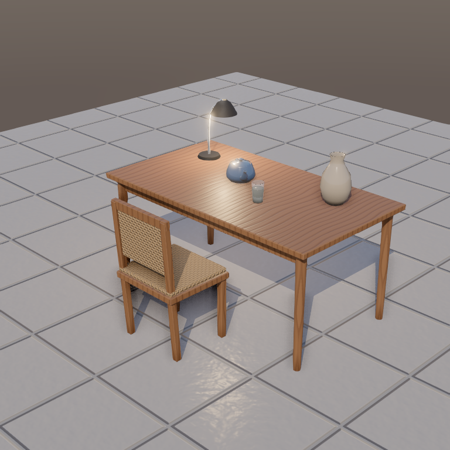

[contributors-shield]: https://img.shields.io/github/contributors/AlStartlight/LindenEngine.svg?style=for-the-badge
[contributors-url]: https://github.com/AlStartlight/LindenEngine/graphs/contributors
[forks-shield]: https://img.shields.io/github/forks/AlStartlight/LindenEngine.svg?style=for-the-badge
[forks-url]: https://github.com/AlStartlight/LindenEngine/network/members
[stars-shield]: https://img.shields.io/github/stars/AlStartlight/LindenEngine.svg?style=for-the-badge
[stars-url]: https://github.com/AlStartlight/LindenEngine/stargazers
[issues-shield]: https://img.shields.io/github/issues/AlStartlight/LindenEngine.svg?style=for-the-badge
[issues-url]: https://github.com/AlStartlight/LindenEngine/issues
[license-shield]: https://img.shields.io/github/license/AlStartlight/LindenEngine.svg?style=for-the-badge
[license-url]: https://github.com/AlStartlight/LindenEngine/blob/main/LICENSE

<div align="center">

# Linden Engine

<p align="center"><strong>A Modern Desktop Game Engine for the Web Era</strong></p>

[![Stargazers][stars-shield]][stars-url] [![Forks][forks-shield]][forks-url]
[![Contributors][contributors-shield]][contributors-url]
[![Issues][issues-shield]][issues-url]
[![MIT License][license-shield]][license-url]

<p align="center">
Build games with TypeScript scripting, HTML/CSS UI, real-time 3D rendering, and a professional-grade editor — all powered by modern web technologies.
</p>

</div>

---

## Welcome to Linden Engine

Linden Engine is a **modern desktop game engine** built with ElectronJS, TypeScript, React, and WebGPU. Inspired by industry-leading engines like Unreal Engine and Unity, Linden Engine provides an intuitive visual editor, powerful scripting capabilities, and cross-platform support — all wrapped in a web-first architecture.

Whether you're a solo indie developer, a student learning game development, or a team building the next big hit, Linden Engine gives you the tools to bring your creative vision to life.

With Linden Engine, you can:

- **Build in real-time** with a professional 3D viewport and live editing
- **Script with TypeScript** for advanced gameplay logic with hot-reload support
- **Build HUDs and menus** in plain HTML/CSS (HtmlUI)
- **Let the AI agent help** — it writes scenes, scripts and UI for you, then playtests them headless
- **Deploy everywhere** — Windows, macOS, Linux, and Web

> **Note:** Linden Engine is currently in **active development** (v0.1 Alpha). Features and APIs may change. We welcome contributions and feedback from the community!

---

## 🎯 Core Features

### Professional Editor

A complete editing environment with all the tools you need:

- **Scene Viewport**: Real-time 3D rendering with transform gizmos
- **Hierarchy Panel**: Organize entities in a tree structure
- **Inspector Panel**: Edit properties and add components, including PBR materials (preset dropdown, sliders, live preview)
- **Scene Settings**: Environment lighting (HDR/EXR), tone mapping, exposure, fog, shadows and post-processing per scene
- **Asset Browser**: The project's `assets/` with thumbnails for glTF/GLB/OBJ models and HDR environments
- **Console**: Debug output and error tracking

### Modern Architecture

- **ECS (Entity Component System)**: Scalable and performant game world management
- **WebGPU Rendering**: Next-gen graphics with Three.js fallback
- **TypeScript**: Type-safe scripting with full IDE support
- **Hot Reload**: See changes instantly without restarting
- **Plugin System**: Extend the engine with custom features

### Cross-Platform

Build once, deploy everywhere:

- ✅ **Desktop**: Windows, macOS, Linux (via Electron)
- ✅ **Web**: Export to HTML5 for browser playback
- 🚧 **Mobile**: Android & iOS support (coming soon)

---

## 📚 Table of Contents

<details>
<summary>Getting Started</summary>

- [Prerequisites](#prerequisites)
- [Installation](#installation)
- [Quick Start](#quick-start)
- [Your First Project](#your-first-project)

</details>

<details>
<summary>Development</summary>

- [Running the Editor](#running-the-editor)
- [Building for Production](#building-for-production)
- [Project Structure](#project-structure)
- [Architecture Overview](#architecture-overview)

</details>

<details>
<summary>Features & Guides</summary>

- [Realistic 3D Objects & Rendering](#realistic-3d-objects--rendering)
- [Scripting with TypeScript](#scripting-with-typescript)
- [Plugin Development](#plugin-development)

</details>

<details>
<summary>API Reference</summary>

- [Engine API](#engine-api)
- [Entity & Components](#entity--components)
- [World & Systems](#world--systems)
- [Scripting API](#scripting-api)

</details>

<details>
<summary>Community & Support</summary>

- [Contributing](#contributing)
- [Roadmap](#roadmap)
- [License](#license)
- [Acknowledgments](#acknowledgments)

</details>

---

## Prerequisites

Before you begin, ensure you have the following installed:

- **Node.js** (v18 or higher) - [Download here](https://nodejs.org/)
- **npm** (v9 or higher) - Comes with Node.js
- **Git** - [Download here](https://git-scm.com/)
- **Visual Studio Code** (recommended) - [Download here](https://code.visualstudio.com/)

Optional but recommended:

- **TypeScript knowledge** - For advanced scripting
- **Basic 3D concepts** - Understanding of vectors, transforms, etc.

---

## Installation

### 1. Clone the Repository

```bash
git clone https://github.com/AlStartlight/LindenEngine.git
cd LindenEngine
```

### 2. Install Dependencies

```bash
npm install
```

This will install all required packages including:

- React 18 & React DOM
- Three.js (3D rendering)
- Electron (desktop app)
- TypeScript
- Tailwind CSS
- And more...

### 3. Verify Installation

```bash
npm run dev
```

If everything is set up correctly, you should see:

```
  VITE v5.0.8  ready in 423 ms

  ➜  Local:   http://localhost:5173/
  ➜  Network: use --host to expose
```

Open your browser and navigate to `http://localhost:5173` to see the editor!

---

## Quick Start

### Running the Editor

There are two ways to run Linden Engine:

#### **Option 1: Web-based Editor** (Faster for development)

```bash
npm run dev
```

Then open your browser to `http://localhost:5173`

**Pros:**
- Faster hot-reload
- Easier debugging with browser DevTools
- No Electron overhead

#### **Option 2: Desktop Editor** (Full Electron experience)

```bash
npm run electron-dev
```

This will open the editor in a native desktop window.

**Pros:**
- Native window controls
- Better performance
- File system access
- Production-ready experience

---

## Your First Project

Let's create a simple scene with a rotating cube:

### Step 1: Start the Editor

```bash
npm run dev
```

### Step 2: Create an Entity

1. In the **Hierarchy** panel (left side), right-click in empty space
2. Select **"Create Empty"**
3. Name it **"Rotating Cube"**

### Step 3: Add a Mesh Component

1. Select the "Rotating Cube" entity in the Hierarchy
2. In the **Inspector** panel (right side), click **"+ Add Component"**
3. Choose **"Mesh Renderer"**
4. In the Mesh Renderer properties, select **"box"** as the primitive (1 m cube) and pick a material preset

### Step 4: Add Rotation Logic with a Script

1. In your project folder, create **`scripts/Rotator.ts`**:

   ```typescript
   export default class Rotator {
     speed = 90 // degrees per second
     ctx: any

     onInit(ctx: any) {
       this.ctx = ctx
     }

     onUpdate(dt: number) {
       const t = this.ctx.entity.getTransform()
       t.rotation = { ...t.rotation, y: t.rotation.y + this.speed * dt }
     }
   }
   ```

2. Select the "Rotating Cube", click **"+ Add Component"** and choose **"Script"**
3. Set **Script** to `scripts/Rotator.ts` (optionally set `{ "speed": 180 }` in **Properties**)

### Step 5: Test Your Scene

1. Click the **Play** button (▶) in the top toolbar
2. Your cube should now rotate smoothly!
3. Click **Stop** (⏹) to stop playback

**Congratulations! You've created your first interactive scene in Linden Engine!** 🎉

---

## Building for Production

### Build Options

```bash
# Build everything (frontend + desktop app)
npm run build:all

# Build frontend only
npm run build

# Build Electron app only
npm run build:electron

# Create distributable packages
npm run electron-builder
```

### Build Output

After building, you'll find:

| Type | Location | Description |
|------|----------|-------------|
| **Web build** | `dist/` | Static files ready to deploy |
| **Desktop app** | `dist-electron/` | Electron bundles |
| **Installers** | `release/` | Platform-specific installers |

### Deployment

#### Web Deployment

Deploy your game to any static hosting service:

```bash
# Build for web
npm run build

# Deploy to Netlify (example)
npm install -g netlify-cli
netlify deploy --prod --dir=dist

# Or deploy to Vercel
npm install -g vercel
vercel --prod
```

#### Desktop Distribution

Create installers for all platforms:

```bash
# Build installers
npm run electron-builder

# Find installers in: release/
# - LindenEngine-Setup-0.1.0.exe    (Windows)
# - LindenEngine-0.1.0.dmg          (macOS)
# - LindenEngine-0.1.0.AppImage     (Linux)
```

---

## Project Structure

```
LindenEngine/
├── 📂 editor/              # React-based editor UI
│   ├── 📂 ui/             # Toolbar, buttons, modals
│   ├── 📂 viewport/       # 3D viewport component
│   ├── 📂 panels/         # Editor panels
│   │   ├── HierarchyPanel.tsx
│   │   ├── InspectorPanel.tsx
│   │   ├── AssetBrowser.tsx
│   │   └── AgentPanel.tsx
│   └── EditorLayout.tsx   # Main layout component
│
├── 📂 engine/             # Core engine code
│   ├── 📂 core/          # Engine lifecycle & initialization
│   ├── 📂 ecs/           # Entity Component System
│   │   ├── Entity.ts
│   │   ├── Component.ts
│   │   └── World.ts
│   ├── 📂 renderer/      # WebGPU + Three.js renderer
│   ├── 📂 physics/       # Physics engine (Rapier)
│   ├── 📂 scripting/     # Script system & lifecycle
│   ├── 📂 assets/        # Asset loader & cache
│   └── 📂 utils/         # Utilities & helpers
│
├── 📂 electron/           # Electron main process
│   └── main.ts
│
├── 📂 plugins/            # Plugin system
├── 📂 shared/             # Shared utilities
├── 📂 public/             # Static assets
├── 📂 docs/               # Documentation
│
├── 📄 package.json
├── 📄 tsconfig.json
├── 📄 vite.config.ts
└── 📄 README.md
```

---

## Architecture Overview

### ECS (Entity Component System)

Linden Engine uses an **Entity Component System** architecture for optimal performance and flexibility.

```typescript
// 🎮 Entities = Containers for components
const player = new Entity('Player')

// 📦 Components = Data containers
player.addComponent(new Transform())
player.addComponent(new MeshRenderer('character.gltf'))
player.addComponent(new RigidBody())
player.addComponent(new Script()) // src: 'scripts/Player.ts'

// ⚙️ Systems = Logic that operates on entities
world.addSystem(new PhysicsSystem())
world.addSystem(new RenderSystem())
world.addSystem(new ScriptSystem())
```

**Benefits of ECS:**
- 🚀 High performance through data-oriented design
- 🔧 Flexible composition over inheritance
- 🎯 Easy to add/remove features at runtime
- 📊 Cache-friendly memory layout

### Engine Lifecycle

```
┌─────────────┐
│ Initialize  │  Load renderer, create world, init systems
└──────┬──────┘
       │
┌──────▼──────┐
│   Start     │  Execute BeginPlay events
└──────┬──────┘
       │
┌──────▼──────┐
│ Update Loop │  ◄───┐
│             │      │
│  - Physics  │      │
│  - Scripts  │      │  60 FPS
│  - Rendering│      │
│  - Input    │      │
└──────┬──────┘      │
       │             │
       └─────────────┘
       │
┌──────▼──────┐
│    Stop     │  Cleanup, save state
└──────┬──────┘
       │
┌──────▼──────┐
│   Dispose   │  Free resources
└─────────────┘
```

### Script Lifecycle

```typescript
export class GameScript implements IGameScript {
  // 🎬 Called once during initialization
  async onInit(context: ScriptContext) {
    console.log('Script initialized')
  }

  // 🔄 Called every frame (~60 FPS)
  onUpdate(deltaTime: number) {
    // Game logic here
  }

  // ⚙️ Called at fixed intervals (for physics)
  onFixedUpdate(deltaTime: number) {
    // Physics calculations here
  }

  // 🧹 Called when script is destroyed
  onDestroy() {
    console.log('Cleanup')
  }

  // 🔥 Hot reload support!
  async onReload(context: ScriptContext) {
    // Reinitialize after code changes
  }
}
```

---

## Realistic 3D Objects & Rendering

The editor viewport, Play and the web export render through one module,
`engine/renderer/sceneFactory.ts`, so a scene looks the same everywhere. 1 unit = 1 meter; primitives are 1 m
(the capsule is Ø1×2 m to match the default capsule collider).

**Rendering** (per scene, `settings` in the `.lscene`, editable in the **Scene** tab):

- sRGB output, AgX/ACES/Neutral tone mapping and exposure
- Image-based lighting: procedural RoomEnvironment by default, or an HDR/EXR from `assets/` as environment and background
- Soft shadows (PCF) with the sun's shadow camera fitted to the scene and texel-scaled bias
- Optional post-processing: GTAO ambient occlusion, bloom, SMAA/FXAA (EffectComposer on WebGL, TSL `RenderPipeline` on WebGPU; an effect that is unavailable is skipped with a warning)
- Project quality profile (**Project Settings → Graphics**): Low (no post-processing, 1024 shadows, no transmission), Medium, High

**Materials** (`engine/materials`): 30+ PBR presets (teak/oak/walnut, steel, chrome, gold, copper, brushed aluminium,
plastics, rubber, glass, water, ceramic, marble, concrete, brick, fabric, leather, grass, soil, sand, stone, car paint...)
with overrides for clearcoat, transmission/IOR/thickness, sheen, iridescence, anisotropy and emission. Wood grain, bricks,
tiles, weave, brushed and scratched metal are generated at runtime (albedo, roughness and normal maps, no downloads);
project textures (`map`, `normalMap`, `roughnessMap`, `metalnessMap`, `aoMap`) are supported with the right color space.

**Models** (`Model` component, `engine/model`): objects built from parts (rounded boxes, lathe profiles for vases and
glasses, extrusions, spline tubes, tapered cylinders, displaced planes) in a hierarchy, merged per material, with GPU
instancing for repeated objects and an optional box/convex-hull collider. glTF/GLB (Draco, Meshopt, KTX2, decoders bundled
locally) and OBJ files from `assets/` are supported, with glTF animations played through `AnimationPlayer`.

**From a prompt**: the Linden Agent looks up real sizes (`linden_dimensions`, 90+ objects), builds the object part by part
(`linden_model_build`, which validates floating or disconnected parts, buried parts, ground contact, scale against the
real object and inverted normals), looks at offscreen renders from four angles (`linden_render_preview`) and corrects
the model before placing it.



`fixtures/realistic-showcase.lscene` (teak table, rattan chair, metal desk lamp, a glass of water, a lathe-turned ceramic
vase, a GLB teapot, HDR environment) is generated with `node scripts/generate-showcase.mjs`; `npm run test:e2e:preview`
renders it with `linden_render_preview` into `docs/showcase/`.

## Scripting with TypeScript

For advanced users, Linden Engine supports **full TypeScript scripting** with hot-reload and type safety.

### Creating a Custom Script

```typescript
import { IGameScript, ScriptContext } from '@engine/scripting/ScriptSystem'
import { Vector3Utils } from '@engine/utils/index'

export class PlayerController implements IGameScript {
  private speed = 5
  private jumpForce = 10
  private isGrounded = false

  async onInit(context: ScriptContext) {
    console.log('Player initialized!')
  }

  onUpdate(deltaTime: number) {
    const input = this.getInput()
    
    // Calculate movement
    const moveDirection = Vector3Utils.normalize({
      x: input.horizontal,
      y: 0,
      z: input.vertical
    })

    // Apply movement
    const rigidbody = context.entity.getComponent('RigidBody')
    if (rigidbody) {
      rigidbody.velocity = Vector3Utils.multiply(
        moveDirection,
        this.speed
      )
    }

    // Jump
    if (input.jump && this.isGrounded) {
      rigidbody?.applyForce({ x: 0, y: this.jumpForce, z: 0 })
      this.isGrounded = false
    }
  }

  onDestroy() {
    console.log('Player destroyed')
  }

  private getInput() {
    return {
      horizontal: 0,
      vertical: 0,
      jump: false
    }
  }
}
```

### Attaching Scripts to Entities

```typescript
import { Entity } from '@engine/ecs/Entity'
import { PlayerController } from './PlayerController'

const player = new Entity('Player')
player.addComponent(new ScriptComponent(PlayerController))
```

---

## Plugin Development

Extend Linden Engine with custom plugins! Add new components, systems, editors, and more.

### Creating a Plugin

```typescript
import { EnginePlugin } from '@engine/core/Plugin'
import { LindenEngine } from '@engine/core/Engine'

export class MyAwesomePlugin implements EnginePlugin {
  name = 'MyAwesomePlugin'
  version = '1.0.0'

  async onLoad(engine: LindenEngine) {
    console.log('🔌 Plugin loaded!')
    
    // Register custom components
    engine.registerComponent('MyComponent', MyComponent)
    
    // Register custom systems
    engine.registerSystem('MySystem', MySystem)
  }

  async onUnload(engine: LindenEngine) {
    console.log('🔌 Plugin unloaded!')
  }

  registerComponents() {
    return [MyComponent, AnotherComponent]
  }

  registerSystems() {
    return [MySystem]
  }
}
```

### Loading Plugins

```typescript
import { LindenEngine } from '@engine/core/Engine'
import { MyAwesomePlugin } from './plugins/MyAwesomePlugin'

const engine = new LindenEngine()
await engine.loadPlugin(new MyAwesomePlugin())
```

---

## Engine API

### Engine Lifecycle

```typescript
import { LindenEngine } from '@engine/core/Engine'

const engine = new LindenEngine({
  canvas: document.getElementById('viewport'),
  width: 1920,
  height: 1080,
  useWebGPU: true
})

// Initialize engine
await engine.initialize()

// Start game loop
engine.start()

// Pause execution
engine.pause()

// Resume execution
engine.resume()

// Stop engine
engine.stop()

// Cleanup resources
engine.dispose()
```

### Accessing Subsystems

```typescript
// Get the world (contains all entities)
const world = engine.getWorld()

// Get the renderer
const renderer = engine.getRenderer()

// Get performance monitor
const monitor = engine.getPerformanceMonitor()

// Get input system
const input = engine.getInputSystem()
```

---

## Entity & Components

### Creating Entities

```typescript
import { Entity } from '@engine/ecs/Entity'
import { Transform } from '@engine/ecs/Component'

// Create entity
const player = new Entity('Player')

// Get/set transform
const transform = player.getTransform()
transform.position = { x: 0, y: 0, z: 0 }
transform.rotation = { x: 0, y: 90, z: 0 }
transform.scale = { x: 1, y: 1, z: 1 }

// Add to world
world.addEntity(player)
```

### Working with Components

```typescript
// Add component
const meshRenderer = player.addComponent(new MeshRenderer())

// Get component
const rigidbody = player.getComponent('RigidBody')

// Check if component exists
if (player.hasComponent('Collider')) {
  // Do something
}

// Remove component
player.removeComponent('OldComponent')

// Get all components
const allComponents = player.getComponents()
```

### Common Components

| Component | Description |
|-----------|-------------|
| `Transform` | Position, rotation, scale |
| `MeshRenderer` | 3D mesh rendering |
| `Camera` | Camera view and projection |
| `Light` | Directional, point, spot lights |
| `RigidBody` | Physics simulation |
| `Collider` | Collision detection |
| `AudioSource` | 3D positional audio |
| `Script` | TypeScript gameplay script |
| `HtmlUI` | HTML/CSS overlay (HUD, menus) |

---

## World & Systems

### Managing the World

```typescript
import { World } from '@engine/ecs/World'

const world = new World()

// Add entity
world.addEntity(entity)

// Get entity by ID
const entity = world.getEntity('entity-id-123')

// Get all entities
const allEntities = world.getEntities()

// Find entities with specific components
const renderables = world.getEntitiesWithComponents('Transform', 'MeshRenderer')

// Remove entity
world.removeEntity('entity-id-123')
```

### Creating Custom Systems

```typescript
import { System } from '@engine/ecs/System'
import { World } from '@engine/ecs/World'

export class RotationSystem extends System {
  name = 'RotationSystem'

  onUpdate(world: World, deltaTime: number) {
    // Get all entities with Transform
    const entities = world.getEntitiesWithComponents('Transform')

    for (const entity of entities) {
      const transform = entity.getComponent('Transform')
      
      // Rotate on Y-axis
      transform.rotation.y += 45 * deltaTime
    }
  }
}

// Register system
world.addSystem(new RotationSystem())
```

---

## Performance Monitoring

Monitor your game's performance in real-time:

```typescript
const monitor = engine.getPerformanceMonitor()

// Get current FPS
const fps = monitor.getFPS()

// Get average FPS
const avgFps = monitor.getAverageFPS()

// Measure specific code
monitor.startMeasure('physics')
// ... physics code here
const elapsed = monitor.endMeasure('physics')

console.log(`Physics took ${elapsed}ms`)

// Print all stats
monitor.printStats()
```

**Output:**

```
Performance Stats:
  FPS: 60.00 (avg: 59.83)
  Frame Time: 16.67ms
  Physics: 2.34ms
  Rendering: 8.12ms
  Scripts: 1.45ms
```

---

## Roadmap

Linden Engine is actively developed. Here's what's coming:

### ✅ Completed (v0.1 Alpha)

- [x] ECS architecture foundation
- [x] WebGPU renderer with Three.js fallback
- [x] Professional editor UI (Hierarchy, Inspector, Viewport)
- [x] TypeScript scripting with hot-reload
- [x] Electron desktop app

### 🚧 In Progress (v0.2 Beta)

- [ ] Asset import pipeline (GLTF, FBX, OBJ)
- [ ] Physics engine (Rapier integration)
- [ ] Audio system (3D positional audio)
- [ ] Particle system
- [ ] UI Canvas system
- [ ] Input management (keyboard, mouse, gamepad)

### 📋 Planned (v0.3)

- [ ] Terrain system
- [ ] Networking (WebSocket multiplayer)
- [ ] Build export wizard
- [ ] Scene serialization/deserialization
- [ ] Prefab system
- [ ] Undo/Redo system

### 🔮 Future (v1.0+)

- [ ] Mobile support (iOS, Android)
- [ ] Advanced post-processing effects
- [ ] Lua scripting support
- [ ] Marketplace for assets and plugins
- [ ] Cloud collaboration
- [ ] AI-powered tools

**Want to contribute?** See our [Contributing Guide](#contributing) below!

---

## Contributing

We welcome contributions from everyone! Whether you're fixing bugs, adding features, improving docs, or sharing ideas — your help is appreciated.

### Ways to Contribute

1. **Report bugs** - Open an issue with reproduction steps
2. **Suggest features** - Share your ideas in Discussions
3. **Fix bugs** - Submit a PR with a bug fix
4. **Add features** - Implement new features (check Roadmap first)
5. **Improve docs** - Fix typos, add examples, write guides
6. **Share feedback** - Let us know what you think!

### Development Workflow

1. **Fork the repository**

   Click the "Fork" button on GitHub

2. **Clone your fork**

   ```bash
   git clone https://github.com/YOUR_USERNAME/LindenEngine.git
   cd LindenEngine
   ```

3. **Create a branch**

   ```bash
   git checkout -b feature/my-awesome-feature
   ```

4. **Make your changes**

   - Write clean, documented code
   - Follow existing code style
   - Add tests if applicable
   - Update documentation

5. **Test your changes**

   ```bash
   npm run dev
   npm run build
   ```

6. **Commit your changes**

   ```bash
   git add .
   git commit -m "Add awesome feature"
   ```

7. **Push to your fork**

   ```bash
   git push origin feature/my-awesome-feature
   ```

8. **Create a Pull Request**

   Go to the original repo and click "New Pull Request"

### Code Style Guidelines

- Use **TypeScript** for all new code
- Follow **ESLint** and **Prettier** rules
- Use **meaningful variable names**
- Add **JSDoc comments** for public APIs
- Keep functions **small and focused**
- Write **tests** for new features

### Commit Message Format

```
type(scope): brief description

Longer description if needed...

Fixes #123
```

**Types:**
- `feat`: New feature
- `fix`: Bug fix
- `docs`: Documentation changes
- `style`: Code formatting
- `refactor`: Code restructuring
- `test`: Adding tests
- `chore`: Maintenance tasks

**Example:**

```
feat(input): add touch button cooldowns

Touch buttons can show a cooldown overlay driven by
ctx.touch.cooldown() from scripts.

Closes #45
```

---

## Community

Join our growing community!

- **Discord** - Chat with other developers (coming soon)
- **GitHub Discussions** - Ask questions, share projects
- **Twitter** - Follow for updates (coming soon)
- **YouTube** - Tutorials and devlogs (coming soon)

### Code of Conduct

Be respectful, inclusive, and kind. We're all here to learn and build cool things together!

---

## License

Linden Engine is licensed under the **MIT License**.

You're free to:
- ✅ Use commercially
- ✅ Modify the source code
- ✅ Distribute
- ✅ Use privately

See [LICENSE](LICENSE) file for full details.

---

## Acknowledgments

Linden Engine wouldn't be possible without these amazing open-source projects:

- [Three.js](https://threejs.org/) - 3D rendering library
- [React](https://react.dev/) - UI framework
- [Electron](https://www.electronjs.org/) - Desktop app framework
- [TypeScript](https://www.typescriptlang.org/) - Type-safe JavaScript
- [Vite](https://vitejs.dev/) - Build tool
- [Tailwind CSS](https://tailwindcss.com/) - Styling framework
- [Zustand](https://github.com/pmndrs/zustand) - State management

Special thanks to:
- **Unreal Engine** & **Unity** - For inspiration
- **Three.js community** - For excellent 3D web tools
- **All contributors** - For making this project better!

---

## FAQ

<details>
<summary><strong>Is Linden Engine free?</strong></summary>

Yes! Linden Engine is completely free and open-source under the MIT License. You can use it for personal or commercial projects.

</details>

<details>
<summary><strong>What platforms can I build for?</strong></summary>

Currently:
- Desktop (Windows, macOS, Linux)
- Web (HTML5)

Coming soon:
- Mobile (iOS, Android)

</details>

<details>
<summary><strong>Can I use Linden Engine for commercial games?</strong></summary>

Absolutely! The MIT License allows commercial use without any royalties or fees.

</details>

<details>
<summary><strong>How does it compare to Unity/Unreal?</strong></summary>

**Pros:**
- Lightweight and fast
- Web-first architecture
- Easy to extend with TypeScript
- No installation size bloat

**Cons:**
- Still in alpha (fewer features)
- Smaller ecosystem
- Not as battle-tested

Linden Engine is perfect for:
- Web games
- Prototyping
- Learning game development
- Small to medium projects

</details>

<details>
<summary><strong>Can I contribute even if I'm a beginner?</strong></summary>

Yes! We welcome contributions from developers of all skill levels. Start with:
- Fixing typos in documentation
- Reporting bugs
- Suggesting features
- Sharing your projects

</details>

---

<div align="center">

## 🚀 Ready to Build Something Amazing?

**[Get Started Now](#installation)** | **[Read the Docs](docs/)** | **[Join Discord](#community)**

Made with ❤️ by the Linden Engine community

</div>
