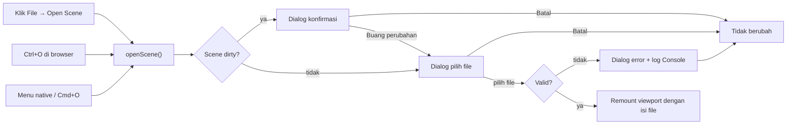

# PRD & Spec: File → Open Scene (Ctrl+O)

23 Okt 2026 · Status: Draft · Bergantung pada [PRD New Scene](./PRD-New-Scene-Ctrl-N.md)

File → Open Scene dan Ctrl+O (Cmd+O di macOS) harus membuka file scene `.lscene` dari disk dan menggantikan scene aktif. Saat ini menu dan shortcut sudah tampil, tetapi tidak melakukan apa-apa, dan engine belum punya format file scene sama sekali. Dokumen ini berisi PRD (bagian 1–7) dan spesifikasi teknis (bagian 8–14).

---

# Bagian A — PRD

## 1. Latar belakang

Kondisi di kode saat ini:

- **Menu web editor** (`editor/ui/Toolbar.tsx`): `<MenuItem label="Open Scene" shortcut="Ctrl+O" />` tidak punya `onClick`.
- **Menu native Electron** (`electron/main.ts`): accelerator `CmdOrCtrl+O` sudah mengirim IPC `menu:openScene`, dan `preload.ts` sudah mengekspos `onMenuOpenScene`. Belum ada kode React yang berlangganan.
- **Baca file** (`electron/main.ts`): handler `file:load` masih stub. Ia hanya mencetak log dan mengembalikan `{ success: true, data: null }`. Belum ada `dialog.showOpenDialog`.
- **Format scene**: belum ada. Scene hanya hidup di memori, di dalam ref Three.js milik `SceneViewport`. `engine/ecs/World.serialize()` ada, tetapi editor tidak memakai `World`.
- **Hierarchy** (`editor/panels/HierarchyPanel.tsx`): masih memakai data statis `sampleHierarchy`, bukan isi scene.

Akibatnya, pekerjaan level tidak bisa dibuka kembali setelah aplikasi ditutup.

## 2. Tujuan dan non-tujuan

**Tujuan**

1. Klik File → Open Scene membuka dialog pilih file yang hanya menampilkan file `.lscene`.
2. Ctrl+O (Windows/Linux) dan Cmd+O (macOS) melakukan hal yang sama.
3. Scene yang dipilih menggantikan scene aktif: objek, transform, material, dan posisi kamera sesuai isi file.
4. File rusak atau tidak valid tidak pernah merusak scene aktif; pengguna melihat pesan error yang jelas.
5. Perubahan yang belum disimpan tidak hilang tanpa konfirmasi (dialog yang sama dengan New Scene).
6. Mendefinisikan format `.lscene` versi 1 yang nanti juga dipakai Save Scene.

**Non-tujuan**

- Save Scene dan Save Scene As (tiket terpisah; memakai format dari dokumen ini).
- Daftar Recent Scenes, drag-and-drop file ke editor, membuka banyak scene sekaligus.
- Menyimpan/memuat Blueprint, Material graph, Animator, dan Sequencer di dalam scene.
- Light buatan pengguna. Di v1 lighting tetap default (ambient + directional + hemisphere).
- Aset eksternal (model glTF, tekstur). v1 hanya primitif bawaan.

## 3. User stories

| ID | Sebagai | Saya ingin | Supaya |
| --- | --- | --- | --- |
| US-1 | Level designer | klik File → Open Scene lalu memilih file | melanjutkan level yang kemarin saya kerjakan |
| US-2 | Pengguna keyboard | menekan Ctrl+O / Cmd+O | membuka scene tanpa membuka menu |
| US-3 | Pengguna yang sudah mengedit scene | diberi peringatan sebelum scene diganti | pekerjaan tidak hilang |
| US-4 | Pengguna yang memilih file rusak | melihat pesan apa yang salah | tahu file mana yang bermasalah, dan scene saya tetap utuh |
| US-5 | Pengguna yang batal di dialog file | tidak ada yang berubah | bisa membatalkan dengan aman |

## 4. Kebutuhan fungsional

| ID | Kebutuhan | Prioritas |
| --- | --- | --- |
| FR-1 | Item File → Open Scene di `Toolbar` memanggil `openScene()` dan menutup dropdown File. | P0 |
| FR-2 | Ctrl+O / Cmd+O memanggil `openScene()`. Di Electron lewat accelerator native (`menu:openScene`); di browser lewat listener `keydown` dengan `preventDefault()`. Satu tekanan = satu dialog. | P0 |
| FR-3 | Jika scene dirty, dialog konfirmasi muncul **sebelum** dialog pilih file. Batal = berhenti, tidak ada dialog file. | P0 |
| FR-4 | Dialog pilih file: judul "Open Scene", filter `Linden Scene (*.lscene)`, satu file, folder awal = folder scene terakhir dibuka atau folder Documents. | P0 |
| FR-5 | Batal di dialog file tidak mengubah apa pun dan tidak menulis log error. | P0 |
| FR-6 | Isi file divalidasi penuh (JSON + schema) **sebelum** scene aktif disentuh. Gagal validasi = scene aktif tetap, dialog error + log Console berisi nama file dan alasan. | P0 |
| FR-7 | File valid: Play mode berhenti, seleksi kosong, viewport di-remount dengan isi file, kamera di posisi dari file, status dirty = bersih. | P0 |
| FR-8 | Hierarchy menampilkan objek dari file, dengan nama dan urutan sesuai file. | P0 |
| FR-9 | Console mencatat `Opened scene: <nama> (<n> objects)`. | P1 |
| FR-10 | Path file disimpan sebagai `currentScenePath` (dipakai Save nanti). Nama scene tampil di toolbar dan judul jendela: `Level01 — Linden Engine`. | P1 |
| FR-11 | File dengan `version` lebih baru dari yang didukung ditolak dengan pesan "Scene dibuat dengan versi engine yang lebih baru". | P1 |
| FR-12 | Field yang tidak dikenal di file diabaikan (forward-compatible), tidak membuat file gagal dibuka. | P2 |

## 5. Alur UX



Konfirmasi ditanyakan sebelum memilih file, bukan sesudahnya: pengguna memutuskan nasib scene lama dulu, dan validasi file yang gagal tetap tidak merusak apa-apa.

**Dialog error**

- Judul: "Gagal membuka scene"
- Isi: `<nama file>` + satu kalimat alasan (lihat tabel kode error di §11).
- Tombol: **OK**.

## 6. Edge case dan risiko

| Kasus | Perilaku / mitigasi |
| --- | --- |
| Ctrl+O saat dialog file atau dialog konfirmasi sudah terbuka | Abaikan (flag `isOpenInProgress`). |
| File > 50 MB | Ditolak sebelum dibaca penuh (`FILE_TOO_LARGE`). |
| File bukan JSON / JSON terpotong | `INVALID_JSON`, scene aktif tetap. |
| `id` objek duplikat atau `parentId` menunjuk objek yang tidak ada | `SCHEMA_INVALID`, pesan menyebut id-nya. |
| `parentId` membentuk siklus | `SCHEMA_INVALID`. |
| Scene berisi 0 objek | Valid; hasilnya scene default kosong. |
| File dihapus/dipindah antara dipilih dan dibaca | `READ_FAILED`. |
| Mode web (`npm run dev`) | Tidak ada akses filesystem; pakai `<input type="file" accept=".lscene">`. `currentScenePath` hanya berisi nama file. |
| Renderer diminta membaca path sembarang | Dicegah: dialog dan pembacaan file terjadi dalam satu handler di main process. Renderer tidak pernah mengirim path. |
| Listener IPC terpasang dua kali (StrictMode) | `onMenuOpenScene` mengembalikan unsubscribe, sama seperti perbaikan di PRD New Scene. |

## 7. Kriteria penerimaan

Diuji di `npm run electron-dev` (Windows + macOS). Poin bertanda (web) juga di `npm run dev`.

- [ ] Klik File → Open Scene memunculkan dialog yang hanya menampilkan `.lscene`; dropdown File tertutup. (web: picker browser)
- [ ] Ctrl+O / Cmd+O memunculkan dialog yang sama; satu tekanan = satu dialog.
- [ ] Buka `fixtures/valid-basic.lscene`: 3 objek muncul dengan posisi, rotasi, skala, dan warna sesuai file; Hierarchy berisi 3 nama itu; kamera di posisi dari file. (web)
- [ ] Pindahkan objek lalu Ctrl+O: dialog konfirmasi muncul sebelum dialog file. Batal = tidak ada dialog file. (web)
- [ ] Batal di dialog file: scene, Console, dan status dirty tidak berubah. (web)
- [ ] Buka `fixtures/invalid-json.lscene`, `fixtures/bad-schema.lscene`, `fixtures/future-version.lscene`: masing-masing menampilkan dialog error dengan alasan yang benar, scene aktif tidak berubah. (web)
- [ ] Setelah membuka file, judul jendela `<nama> — Linden Engine`.
- [ ] Buka 20 scene berturut-turut: tidak ada warning `Too many active WebGL contexts`.
- [ ] Unit test schema & `buildSceneFromData` lolos; `npm run type-check` dan `npm run build` lolos.

---

# Bagian B — Spesifikasi teknis

## 8. Ringkasan arsitektur

```
Renderer (React)                                  Main (Electron)
────────────────                                  ───────────────
Toolbar ──onOpenScene──┐
keydown Ctrl+O (web) ──┼─► EditorLayout.openScene()
onMenuOpenScene(IPC) ──┘        │
                                ├─ dirty? → ConfirmDialog
                                ├─ sceneIO.pickAndReadScene() ──IPC 'scene:open'──► dialog.showOpenDialog
                                │                                                   fs.stat + fs.readFile
                                │      ◄────────── { status, fileName, path, content } ──┘
                                ├─ parseSceneFile(content)   (JSON.parse + zod)
                                └─ setLoadedScene(data); sceneKey + 1
                                         │
                                         ▼
                        <SceneViewport key={sceneKey} initialScene={data}/>
                                         │ buildSceneFromData(scene, data)
                                         └─ onObjectsChange → HierarchyPanel
```

Prinsip:

- **Main process** hanya memilih dan membaca byte file. Tidak mem-parse.
- **Renderer** mem-parse dan memvalidasi di modul murni (`engine/scene/`) supaya bisa di-unit-test dan dipakai ulang oleh Save Scene.
- **Validasi selesai sebelum remount.** Viewport hanya menerima data yang sudah lolos schema.

## 9. Format file `.lscene` v1

File JSON UTF-8. Ekstensi `.lscene`. Satuan: posisi dalam unit dunia, rotasi dalam **derajat** (sama dengan Inspector), warna hex `#rrggbb`.

```json
{
  "format": "linden-scene",
  "version": 1,
  "name": "Level01",
  "camera": {
    "position": [10, 10, 10],
    "target": [0, 0, 0]
  },
  "objects": [
    {
      "id": "cube-1",
      "name": "Cube",
      "parentId": null,
      "kind": "primitive",
      "primitive": "box",
      "transform": {
        "position": [0, 1, 0],
        "rotation": [0, 45, 0],
        "scale": [1, 1, 1]
      },
      "material": { "color": "#00aaff", "roughness": 0.5, "metalness": 0.5 },
      "castShadow": true,
      "receiveShadow": true,
      "visible": true
    }
  ]
}
```

**Primitif yang didukung** — ukuran geometri tetap, sama dengan `addSampleObjects()` saat ini, sehingga ukuran objek hanya diatur lewat `scale`:

| `primitive` | Geometri Three.js |
| --- | --- |
| `box` | `BoxGeometry(2, 2, 2)` |
| `sphere` | `SphereGeometry(1, 32, 32)` |
| `cylinder` | `CylinderGeometry(0.5, 0.5, 3, 32)` |
| `torus` | `TorusGeometry(1, 0.4, 16, 100)` |
| `cone` | `ConeGeometry(1, 2, 32)` |
| `plane` | `PlaneGeometry(2, 2)` |

Grid, axes helper, ground, dan lighting default **tidak** disimpan di file; selalu dibuat oleh viewport.

## 10. Schema validasi (zod)

`zod` sudah ada di `dependencies`. File baru `engine/scene/SceneSchema.ts`:

```ts
import { z } from 'zod'

export const SCENE_FORMAT = 'linden-scene'
export const SCENE_VERSION = 1
export const MAX_SCENE_BYTES = 50 * 1024 * 1024

const Vec3 = z.tuple([z.number().finite(), z.number().finite(), z.number().finite()])
const HexColor = z.string().regex(/^#[0-9a-fA-F]{6}$/)

export const PrimitiveKind = z.enum(['box', 'sphere', 'cylinder', 'torus', 'cone', 'plane'])

const SceneObject = z.object({
  id: z.string().min(1).max(128),
  name: z.string().max(256),
  parentId: z.string().nullable().default(null),
  kind: z.literal('primitive'),
  primitive: PrimitiveKind,
  transform: z.object({
    position: Vec3,
    rotation: Vec3,
    scale: Vec3,
  }),
  material: z.object({
    color: HexColor,
    roughness: z.number().min(0).max(1),
    metalness: z.number().min(0).max(1),
  }),
  castShadow: z.boolean().default(true),
  receiveShadow: z.boolean().default(true),
  visible: z.boolean().default(true),
})

export const SceneFileSchema = z
  .object({
    format: z.literal(SCENE_FORMAT),
    version: z.number().int().min(1),
    name: z.string().min(1).max(256),
    camera: z.object({ position: Vec3, target: Vec3 }),
    objects: z.array(SceneObject).max(10_000),
  })
  .superRefine((scene, ctx) => {
    // id unik, parentId valid, tanpa siklus
  })

export type SceneFile = z.infer<typeof SceneFileSchema>
export type SceneObjectData = SceneFile['objects'][number]
```

Catatan: `z.object` secara default membuang field tidak dikenal, sesuai FR-12. Pengecekan `version > SCENE_VERSION` dilakukan di `parseSceneFile` sebelum schema, agar menghasilkan kode error `UNSUPPORTED_VERSION` yang spesifik.

## 11. API modul dan kontrak IPC

### 11.1 `engine/scene/parseSceneFile.ts` (baru, murni)

```ts
export type SceneLoadErrorCode =
  | 'INVALID_JSON'
  | 'NOT_A_SCENE'          // format !== 'linden-scene'
  | 'UNSUPPORTED_VERSION'  // version > SCENE_VERSION
  | 'SCHEMA_INVALID'
  | 'FILE_TOO_LARGE'
  | 'READ_FAILED'

export type ParseResult =
  | { ok: true; scene: SceneFile }
  | { ok: false; code: SceneLoadErrorCode; message: string }

export function parseSceneFile(content: string): ParseResult
```

| Kode | Pesan untuk pengguna |
| --- | --- |
| `INVALID_JSON` | File bukan JSON yang valid. |
| `NOT_A_SCENE` | File ini bukan scene Linden Engine. |
| `UNSUPPORTED_VERSION` | Scene dibuat dengan versi engine yang lebih baru (v{n}). |
| `SCHEMA_INVALID` | Isi scene tidak valid: {path zod pertama} — {pesan}. |
| `FILE_TOO_LARGE` | File lebih dari 50 MB. |
| `READ_FAILED` | File tidak bisa dibaca: {pesan OS}. |

### 11.2 `engine/scene/buildScene.ts` (baru)

```ts
export function createPrimitiveMesh(obj: SceneObjectData): THREE.Mesh
export function buildSceneFromData(scene: THREE.Scene, data: SceneFile): Map<string, THREE.Object3D>
```

- Membuat mesh per objek, mengisi `userData = { id, name, selectable: true, type: 'primitive', primitive }` (kompatibel dengan raycast & Inspector saat ini).
- Rotasi derajat → radian via `THREE.MathUtils.degToRad`.
- Objek dengan `parentId` di-`add` ke parent-nya setelah semua mesh dibuat.
- Mengembalikan map `id → Object3D` untuk `objectsRef`.

### 11.3 IPC `scene:open` (main process)

Ditambahkan di `electron/main.ts`. Handler `file:load` yang menerima path dari renderer **tidak** dipakai.

```ts
type OpenSceneResult =
  | { status: 'canceled' }
  | { status: 'ok'; path: string; fileName: string; content: string }
  | { status: 'error'; code: 'FILE_TOO_LARGE' | 'READ_FAILED'; fileName?: string; message: string }

ipcMain.handle('scene:open', async (_e, opts: { defaultDir?: string }): Promise<OpenSceneResult> => {
  const res = await dialog.showOpenDialog(mainWindow!, {
    title: 'Open Scene',
    defaultPath: opts?.defaultDir ?? app.getPath('documents'),
    filters: [{ name: 'Linden Scene', extensions: ['lscene'] }],
    properties: ['openFile'],
  })
  if (res.canceled || res.filePaths.length === 0) return { status: 'canceled' }
  const path = res.filePaths[0]
  // fs.stat → tolak jika > MAX_SCENE_BYTES; lalu fs.readFile(path, 'utf8')
})
```

`preload.ts`:

```ts
openSceneDialog: (opts?: { defaultDir?: string }) => ipcRenderer.invoke('scene:open', opts),
onMenuOpenScene: (callback: () => void) => {
  const listener = () => callback()
  ipcRenderer.on('menu:openScene', listener)
  return () => ipcRenderer.removeListener('menu:openScene', listener)
},
```

Tipe global `Window.electronAPI` diperbarui sesuai (return type `() => void` untuk `onMenu*`).

### 11.4 `editor/io/sceneIO.ts` (baru) — abstraksi Electron vs web

```ts
export type PickResult =
  | { status: 'canceled' }
  | { status: 'ok'; fileName: string; path: string | null; content: string }
  | { status: 'error'; code: SceneLoadErrorCode; fileName?: string; message: string }

export async function pickAndReadScene(defaultDir?: string): Promise<PickResult>
```

- Electron: memanggil `window.electronAPI.openSceneDialog`.
- Web: membuat `<input type="file" accept=".lscene">` sementara, membaca dengan `file.text()`, mengecek `file.size` terhadap `MAX_SCENE_BYTES`. Event `cancel` input → `canceled`.

## 12. Perubahan per file

| File | Perubahan |
| --- | --- |
| `engine/scene/SceneSchema.ts` (baru) | Schema zod, konstanta format/versi/batas ukuran. |
| `engine/scene/parseSceneFile.ts` (baru) | JSON.parse + cek format/versi + schema → `ParseResult`. |
| `engine/scene/buildScene.ts` (baru) | `createPrimitiveMesh`, `buildSceneFromData`. |
| `engine/scene/index.ts` (baru) | Re-export, mengikuti pola `engine/materials/index.ts`. |
| `editor/io/sceneIO.ts` (baru) | `pickAndReadScene()` untuk Electron dan web. |
| `editor/EditorLayout.tsx` | State `loadedScene: SceneFile \| null`, `currentScenePath`, `sceneName`, `isOpenInProgress`. Fungsi `openScene()` sesuai alur §5. Langganan `onMenuOpenScene` dengan cleanup; listener `keydown` Ctrl/Cmd+O hanya bila `window.electronAPI` tidak ada. Dialog error memakai `ConfirmDialog` mode satu tombol. |
| `editor/ui/Toolbar.tsx` | Prop `onOpenScene`; item Open Scene memanggilnya lalu menutup dropdown. Prop `sceneName` menggantikan teks statis `Linden Engine`. |
| `editor/viewport/SceneViewport.tsx` | Prop `initialScene?: SceneFile`. Jika ada: lewati `addSampleObjects`, panggil `buildSceneFromData`, set kamera dari `initialScene.camera`. Panggil `onObjectsChange` setelah build. |
| `editor/panels/HierarchyPanel.tsx` | Prop `items` (dari PRD New Scene) — dipakai juga di sini. |
| `electron/main.ts` | Import `dialog`, `fs/promises`; handler `scene:open`; set judul jendela lewat IPC `window:setTitle` (atau `document.title` di renderer — cukup salah satu). |
| `electron/preload.ts` | `openSceneDialog`, `onMenuOpenScene` dengan unsubscribe, tipe diperbarui. |
| `fixtures/*.lscene` (baru) | `valid-basic`, `valid-hierarchy`, `invalid-json`, `bad-schema`, `future-version`, `duplicate-id`. |

Ketergantungan dengan New Scene: `isSceneDirty`, `ConfirmDialog`, `sceneKey`-remount, `forceContextLoss()`, dan Hierarchy berbasis prop dibangun di tiket New Scene. Jika Open Scene dikerjakan lebih dulu, bagian-bagian itu ikut dibangun di sini.

## 13. Pseudocode `openScene()`

```ts
const openScene = useCallback(async () => {
  if (isOpenInProgress.current) return
  isOpenInProgress.current = true
  try {
    if (isSceneDirty && !(await confirmDiscard())) return

    const picked = await pickAndReadScene(lastSceneDir)
    if (picked.status === 'canceled') return
    if (picked.status === 'error') return showLoadError(picked.fileName, picked.message)

    const parsed = parseSceneFile(picked.content)
    if (!parsed.ok) return showLoadError(picked.fileName, parsed.message)

    setIsPlaying(false)
    setSelectedObject(null)
    setLoadedScene(parsed.scene)
    setCurrentScenePath(picked.path)
    setSceneName(parsed.scene.name)
    setIsSceneDirty(false)
    setSceneKey(k => k + 1)
    addConsoleMessage('info', `Opened scene: ${parsed.scene.name} (${parsed.scene.objects.length} objects)`)
  } finally {
    isOpenInProgress.current = false
  }
}, [isSceneDirty, lastSceneDir])
```

## 14. Rencana pengujian

**Unit test** (`parseSceneFile`, `buildSceneFromData`). Project belum punya test runner; usulan menambah `vitest` sebagai devDependency (cocok dengan Vite).

| Kasus | Input | Hasil |
| --- | --- | --- |
| Valid minimal | `objects: []` | `ok: true` |
| Valid lengkap | `valid-basic.lscene` | 3 objek, transform persis |
| Rotasi | `rotation: [0, 90, 0]` | `mesh.rotation.y ≈ π/2` |
| Hierarki | child dengan `parentId` | `child.parent === parentMesh` |
| JSON rusak | `{"format":` | `INVALID_JSON` |
| Format salah | `format: "other"` | `NOT_A_SCENE` |
| Versi baru | `version: 2` | `UNSUPPORTED_VERSION` |
| Primitif tak dikenal | `primitive: "teapot"` | `SCHEMA_INVALID`, path `objects.0.primitive` |
| Id duplikat | dua `cube-1` | `SCHEMA_INVALID` |
| Siklus parent | A→B→A | `SCHEMA_INVALID` |
| Field asing | `"foo": 1` di objek | `ok: true`, field dibuang |

**Manual / E2E**: checklist di §7.

## 15. Pertanyaan terbuka

- [ ] Ekstensi `.lscene` sudah oke, atau lebih suka `.scene.json` agar mudah dibuka editor teks?
- [ ] Rotasi disimpan dalam derajat (ramah manusia, sama dengan Inspector) atau radian (native Three.js)?
- [ ] Apakah Open Scene perlu dikerjakan setelah Save Scene, supaya pengguna bisa membuat file `.lscene` dari editor? Sampai Save ada, file hanya dari `fixtures/` atau ditulis tangan.
- [ ] Tambah `vitest` sekarang, atau unit test ditunda?
