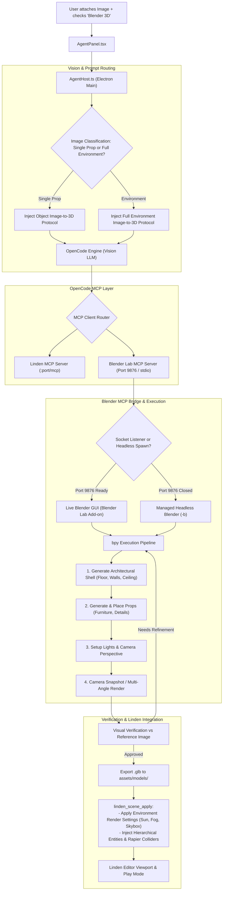

# SPEC: Image-to-3D Object & Full Environment Generation via Blender MCP Server

**Status:** Implemented (M0–M6 complete)  
**Target:** LindenEngine Agent (`AgentHost`, `AgentPanel`, OpenCode MCP integration, Blender Bridge)  
**Reference:** Official Blender Lab MCP Server ([blender.org/lab/mcp-server](https://www.blender.org/lab/mcp-server/))  
**Related Specs:** [`SPEC-Blender-3D-Agent.md`](./SPEC-Blender-3D-Agent.md), [`SPEC-Img2ThreeJS-Agent.md`](./SPEC-Img2ThreeJS-Agent.md)

---

## 1. Executive Summary & Problem Statement

### 1.1 The Issue
In LindenEngine, when a user uploads a reference image (e.g. a prop, or an entire scene such as a cozy bedroom, a medieval dungeon, a sci-fi corridor, or an outdoor landscape) and checks the **"Blender 3D"** checkbox in the Agent Panel:
1. **The agent fails to interpret the image into 3D using Blender.** Instead, it either falls back to simple procedural parts (`linden_model_build`), generates hand-coded Three.js factories (`linden_factory_write`), or produces an isolated, generic primitive approximation.
2. **The agent cannot generate an entire cohesive 3D environment similar to the uploaded image.** Users expect that uploading an image of a room, level, or world concept with "Blender 3D" checked will reconstruct the complete environment:
   - Atmospheric lighting, sky/environment reflections, fog, and mood.
   - Architectural layout (floor, walls, ceiling, terrain, structural columns, doors, windows).
   - Spatial distribution of interconnected props and furnishings.
   - Local light sources (lamps, torches, glowing monitors, window light).
   - Direct injection into the active Linden `.lscene` with physics colliders.

### 1.2 Root Cause Analysis
Examination of the codebase reveals five architectural, prompting, and protocol blockers:

1. **Instruction Conflict in `attachmentNote` (`electron/agent/referenceImages.ts`)**:
   `attachmentNote()` unconditionally appends:
   ```text
   Untuk membangun ulang objek di gambar sebagai model 3D, ikuti bagian 7 instruksi Linden
   (linden_model_build / linden_factory_write, bandingkan dengan linden_reference_view).
   ```
   Even when `useBlender` is true, the LLM receives an explicit command to follow Section 7 (Three.js procedural factory writing), preventing it from utilizing Blender.

2. **Absence of Environment & Scene Decomposition Guidance in `blender.md`**:
   [`electron/agent/prompts/blender.md`](file:///Users/asep/Documents/Github/LindenEngine/electron/agent/prompts/blender.md) only provides instructions for simple single-object declarative specs (`linden_blender_build`) and bipedal character rigging (`linden_blender_rig_character`). It lacks:
   - Scene-level perspective estimation (camera focal length, vanishing points, camera height).
   - Environmental decomposition (lighting estimation, fog, sky palette).
   - Spatial layout rules (room envelope, prop coordinates, hierarchy).
   - Bridge instructions to Linden's scene graph (`linden_scene_apply` with render `settings` and `entities`).

3. **One-Shot Batch Runner Limitation (`runner.py`)**:
   The existing bridge executes Blender as a single-turn, headless CLI process (`blender -b -P runner.py --spec ...`). Generating a full environment requires interactive scene queries, multi-angle camera previews, iterative modifier adjustments, and collection hierarchy inspection that a blind batch runner cannot support.

4. **Integration Gap with the Official Blender Lab MCP Server**:
   The Blender Foundation released the official **Blender Lab MCP Server** (`https://www.blender.org/lab/mcp-server/`). LindenEngine embeds OpenCode with native Model Context Protocol (MCP) support (`client.mcp.add(...)`), but currently only registers its internal `linden` MCP server, missing the opportunity to expose Blender's live Python runtime (`bpy`) and toolset to the agent.

5. **Scene Synchronization Disconnect (`linden_scene_apply` vs Blender Export)**:
   There is no unified pipeline connecting a generated Blender environment model or modular collection with Linden's scene settings (`sun`, `ambientColor`, `fog`, `skybox`, `postFx`) to replicate the exact visual mood of the uploaded image.

---

## 2. Core Objectives & Scope

### 2.1 Objectives
1. **Intelligent Mode Detection (Object vs. Full Environment):**
   - **Single-Object Mode:** When an isolated item (weapon, prop, furniture) is uploaded, reconstruct that object with high fidelity, bevels, PBR materials, and clean topology.
   - **Full Environment Mode:** When a room, building, landscape, or scene concept is uploaded, extract the spatial structure, mood, and furnishings, generate all 3D assets in Blender, and construct the complete Linden scene.
2. **Blender MCP Server Integration ([blender.org/lab/mcp-server](https://www.blender.org/lab/mcp-server/)):**
   - **Mode A (Live Blender):** Connect to the user's interactive Blender instance running the Blender Lab MCP Add-on over TCP socket (port `9876`) via a stdio bridge.
   - **Mode B (Headless Managed Daemon):** If Blender is not running in the foreground, Linden automatically spawns a background Blender MCP daemon (`blender -b -P blender-bridge/mcp_server.py`) over stdio.
   - **Mode C (Fallback Spec Runner):** Deterministic fallback if socket communication is unavailable.
3. **Multimodal Visual Environment Extraction:**
   - **Lighting & Atmosphere:** Sun/directional light angle & color, ambient light, fog density/color, tone mapping, and skybox/HDR.
   - **Architectural Shell:** Floor/terrain bounds, wall heights, ceilings, structural openings (doors/windows).
   - **Prop Inventory & Spatial Coordinates:** Decompose visible objects into 3D metric coordinates $[x, y, z]$, scales, and orientations.
4. **Visual Verification Loop:**
   - Position Blender's camera to match the estimated perspective of the uploaded photo.
   - Capture preview renders via Blender MCP and compare against the uploaded image (`linden_reference_view`).
   - Self-correct scale, lighting, and placement before committing.
5. **Direct Linden Scene Ingestion:**
   - Output `.glb` models to `assets/models/`.
   - Update `scenes/<SceneName>.lscene` via `linden_scene_apply` with matching render settings (`settings`) and hierarchical entities (`entities`) with Rapier colliders.

### 2.2 Non-Goals
- Running neural NeRF/Gaussian Splatting reconstruction models inside Electron. The pipeline leverages the multimodal intelligence of the vision LLM (Claude 3.7 Sonnet, GPT-4o, Gemini 2.0/3.8) driving Blender via MCP.
- Destructive modification of user `.blend` files outside the active project.
- Real-time physics simulation of destructible fluid/cloth during generation.

---

## 3. System Architecture & Component Diagram

### 3.1 Architectural Flow



### 3.2 Dual-Connection Bridge Specification

```
┌────────────────────────────────────────────────────────┐
│ Linden Electron (Node.js)                              │
│                                                        │
│  AgentHost.ts ──► OpenCode Client                      │
│                        │                               │
│                        ▼ (stdio JSON-RPC)              │
│               blender-bridge/mcp_proxy.js              │
└────────────────────────┬───────────────────────────────┘
                         │
        ┌────────────────┴────────────────┐
        │ Mode A: TCP Socket :9876        │ Mode B: Child Process (stdio)
        ▼                                 ▼
┌───────────────────────────────┐ ┌───────────────────────────────┐
│ Active Blender GUI            │ │ Background Blender Process    │
│ (Blender Lab MCP Add-on)      │ │ blender -b -P mcp_server.py   │
│ - bpy in live scene           │ │ - bpy in isolated sandbox     │
│ - Real-time viewport update   │ │ - Headless GLB export         │
└───────────────────────────────┘ └───────────────────────────────┘
```

1. **`mcp_proxy.js`**: Node.js stdio-to-TCP/spawn multiplexer.
   - Probes `127.0.0.1:9876` with a $300\text{ ms}$ timeout.
   - If port `9876` responds (official Blender Lab extension is running in Blender): connects via TCP and tunnels OpenCode MCP stdio directly to the live Blender session.
   - If port `9876` is closed: spawns `blender -b --factory-startup -Y --offline-mode -P blender-bridge/mcp_server.py` and pipes stdio directly.
2. **OpenCode Configuration in `AgentHost.ts`**:
   ```typescript
   const config = {
     type: 'stdio' as const,
     command: 'node',
     args: [resolveAppResource('blender-bridge/mcp_proxy.js', 'blender-bridge/mcp_proxy.js'), blenderBinPath],
     timeout: { execution: 15 * 60 * 1000 },
   }
   await client.mcp.add({ server: 'blender', location: this.location(), config })
   ```

---

## 4. Full Environment Generation Protocol

When the user uploads a scene/environment image (e.g., room interior, courtyard, dungeon, street), the agent executes a structured 5-stage reconstruction workflow:

### Stage 1: Visual Scene & Atmospheric Decomposition
The multimodal LLM inspects the image and produces a structured scene breakdown:

```json
{
  "sceneType": "interior_room",
  "estimatedDimensions": { "width": 5.0, "length": 6.5, "height": 2.8 },
  "cameraEstimate": {
    "fov": 65,
    "position": [0.0, 1.6, -3.2],
    "rotation": [-10, 0, 0]
  },
  "atmosphere": {
    "sun": { "enabled": true, "color": "#ffe8d1", "intensity": 2.2, "direction": [-0.6, 0.8, -0.4] },
    "ambient": { "color": "#2c3345", "intensity": 0.35 },
    "fog": { "enabled": false, "color": "#c8d2dc", "density": 0.01 },
    "skybox": "room",
    "toneMapping": "agx",
    "exposure": 1.1
  },
  "architecturalShell": [
    { "type": "floor", "size": [5.0, 6.5], "material": "dark_hardwood", "color": "#3e2723" },
    { "type": "wall_back", "size": [5.0, 2.8], "material": "plaster", "color": "#e0e0e0" },
    { "type": "window", "wall": "wall_left", "position": [-2.49, 1.4, 0.5], "size": [1.6, 1.4] }
  ],
  "primaryProps": [
    { "name": "bed", "position": [1.2, 0.0, 1.5], "rotation": [0, 0, 0], "dimensions": [1.8, 2.1, 0.9] },
    { "name": "study_desk", "position": [-1.6, 0.0, 0.8], "rotation": [0, 90, 0], "dimensions": [1.4, 0.7, 0.75] },
    { "name": "office_chair", "position": [-1.6, 0.0, 0.2], "rotation": [0, 30, 0], "dimensions": [0.6, 0.6, 0.95] }
  ],
  "accentLights": [
    { "type": "point", "name": "desk_lamp", "position": [-1.4, 0.85, 0.6], "color": "#ffb74d", "intensity": 8.0, "distance": 4.0 }
  ]
}
```

### Stage 2: Architectural Shell & Environment Construction in Blender
The agent invokes Blender MCP tools / `bpy` script execution to build the room envelope:
1. **Floor & Ceiling:** Created as solid slabs with thickness ($0.15\text{ m}$) to prevent light leaking.
2. **Walls & Openings:** Extruded perimeter with Boolean cutters for windows and doors.
3. **Bevels & Trim:** Baseboards, crown moldings, and window frames bevelled ($0.015\text{ m}$) for realistic edge highlights under lighting.
4. **Materials:** PBR shaders created with Principled BSDF (albedo hex, roughness, and normal bump maps).

### Stage 3: Modular Prop Generation & Spatial Placement
For each identified prop:
1. Created with metric dimensions based on real-world reference tables (e.g. desk height $0.75\text{ m}$, chair seat $0.45\text{ m}$).
2. Modifier stack applied: Bevel $\rightarrow$ Subdivision Surface $\rightarrow$ Solidify $\rightarrow$ Mirror.
3. Placed at calculated $[x, y, z]$ coordinates resting on the floor plane ($y=0$ in Linden, $z=0$ in Blender).
4. Export options:
   - **Option A (Cohesive Scene GLB):** For compact interiors/levels, all objects are exported in a single, well-structured GLB preserving object names and hierarchy (`assets/models/environments/<name>_env.glb`).
   - **Option B (Modular Asset Kit):** For larger or interactive levels, key interactive items (doors, chests, chairs) are exported as individual reusable `.glb` files.

### Stage 4: Visual Camera Matching & Verification Loop
1. Agent creates a temporary Blender camera matching `cameraEstimate` (position, tilt, FOV).
2. Agent calls `blender_render_viewport` to get a snapshot from this perspective.
3. Agent compares the snapshot against the uploaded reference image:
   - Check 1: Silhouette and bounding envelope of major structures.
   - Check 2: Light direction and shadow angles matching the photo's windows/lamps.
   - Check 3: Color palette fidelity and material roughness.
4. If discrepancies exceed acceptable tolerance, the agent refines transforms or modifier values (capped at **3 iterations**).

### Stage 5: Linden Scene Ingestion (`linden_scene_apply`)
Once exported, the agent commits the environment directly to Linden:
1. Sets scene `settings`:
   - `sun`: Color, intensity, and direction extracted from the image.
   - `ambientColor` and `ambientIntensity`: Matching room bounce light.
   - `fog`: Enabled if the image exhibits atmospheric haze/fog.
   - `toneMapping` & `postFx`: Bloom for glowing lights, AO for contact shadows.
2. Populates `entities`:
   - Adds the environment model entity with `MeshCollider` (trimesh) or compound box colliders.
   - Adds point/spot `LightComponent` entities at physical light fixture positions.
   - Sets up default camera / player spawn point.

---

## 5. Detailed Code & File Changes

### 5.1 `electron/agent/referenceImages.ts`
Update `attachmentNote` to handle both single-object and full-environment prompts when `useBlender` is enabled:

```typescript
export function attachmentNote(paths: string[], useBlender = false): string {
  if (paths.length === 0) return ''
  const list = paths.map((p) => `- ${p}`).join('\n')

  if (useBlender) {
    return (
      `\n\n<reference-images>\n` +
      `Gambar referensi dari user (di folder proyek):\n${list}\n` +
      `MODE BLENDER 3D AKTIF: Bangun objek atau seluruh lingkungan (environment) 3D sesuai gambar menggunakan Blender MCP.\n` +
      `- Bila gambar berupa satu objek/prop: rekonstruksi model 3D di Blender dan ekspor ke assets/models/<nama>.glb.\n` +
      `- Bila gambar berupa pemandangan/ruangan/lingkungan (environment): ekstrak tata letak ruang, pencahayaan, dan prop, ` +
      `bangun seluruh environment di Blender, ekspor GLB, lalu sesuaikan settings scene (sun, ambient, fog) dan entities via linden_scene_apply.\n` +
      `Ikuti petunjuk lengkap di blok <blender-mode>. JANGAN membuat Three.js factory hand-written.\n` +
      `</reference-images>`
    )
  }

  return (
    `\n\n<reference-images>\n` +
    `Gambar referensi dari user (di folder proyek):\n${list}\n` +
    `Untuk membangun ulang objek di gambar sebagai model 3D, ikuti bagian 7 instruksi Linden ` +
    `(linden_model_build / linden_factory_write, bandingkan dengan linden_reference_view).\n` +
    `</reference-images>`
  )
}
```

### 5.2 `electron/agent/AgentHost.ts`
1. **Pass `options.useBlender`** into `attachmentNote(attachments, options.useBlender)`.
2. **Register Blender MCP Server** in OpenCode client on startup and whenever Blender detection state updates:
   ```typescript
   private async registerBlenderMcp(): Promise<void> {
     const client = this.requireClient()
     const status = getBlenderStatus()
     if (!status.found || !status.path) {
       await client.mcp.remove({ server: 'blender', location: this.location() } as any).catch(() => {})
       return
     }

     const config = {
       type: 'stdio' as const,
       command: 'node',
       args: [resolveAppResource('blender-bridge/mcp_proxy.js', 'blender-bridge/mcp_proxy.js'), status.path],
       timeout: { execution: 15 * 60 * 1000 },
     }
     await client.mcp.remove({ server: 'blender', location: this.location() } as any).catch(() => {})
     await client.mcp.add({ server: 'blender', location: this.location(), config })
   }
   ```
3. **Session Permissions**:
   Add permissions for `blender*` tools in `SESSION_PERMISSIONS`:
   ```typescript
   { action: 'mcp', resource: 'blender*', effect: 'allow' as const },
   { action: 'blender*', resource: '*', effect: 'allow' as const },
   ```

### 5.3 `electron/agent/prompts/blender.md`
Add comprehensive instructions for both Single-Object and Full-Environment image-to-3D workflows:

```markdown
## Rekonstruksi Gambar Referensi ke 3D (<reference-images>)
Saat user melampirkan gambar dan mode Blender 3D aktif, tentukan apakah gambar adalah **Satu Objek (Prop)** atau **Seluruh Lingkungan (Environment/Scene)**:

### Tipe A: Satu Objek (Prop / Item / Karakter)
1. Analisis gambar: estimasi dimensi meter nyata, identifikasi bagian primitif, bevel radius, potongan boolean, dan warna/material PBR.
2. Bangun objek di Blender via Blender MCP (`blender_execute_code` atau `linden_blender_build`).
3. Terapkan modifier (Bevel, Subsurf, Solidify), letakkan dasar objek di Z=0.
4. Ekspor ke `assets/models/<nama>.glb`, lalu pasang di scene: `linden_model_build { model: { src } }`.

### Tipe B: Seluruh Lingkungan (Environment / Ruangan / Level / Landscape)
1. **Ekstraksi Suasana & Pencahayaan:**
   - Arah dan warna matahari (`sun`), warna ambient/pantulan, densitas kabut (`fog`), dan gaya tone mapping (`agx`).
2. **Struktur Arsitektur (Shell):**
   - Buat lantai, dinding, plafon/langit-langit, dan bukaan (jendela/pintu) dengan skala metrik akurat.
3. **Pembuatan & Penempatan Prop:**
   - Buat furnitur dan dekorasi sesuai gambar, posisikan dengan koordinat 3D yang tepat.
4. **Verifikasi Perspektif Visual:**
   - Atur kamera Blender sesuai sudut pandang foto referensi, render snapshot via Blender MCP, dan bandingkan komposisi.
5. **Penerapan ke Scene Linden (`linden_scene_apply`):**
   - Masukkan `settings` (sun direction/color, ambientColor, fog, skybox).
   - Masukkan `entities` (model environment `.glb`, collider, dan lampu titik/spot).
```

### 5.4 `blender-bridge/mcp_proxy.js` & `blender-bridge/mcp_server.py`
Implement the MCP bridge handling:
- Communication with official Blender Lab add-on socket (`127.0.0.1:9876`).
- Automatic fallback spawning of `blender -b -P blender-bridge/mcp_server.py`.
- MCP Tools exposed:
  - `blender_execute_code { code: string }`: Executes sandboxed `bpy` commands.
  - `blender_build_environment { config: object }`: Procedural generator for room envelopes, lighting, and layout.
  - `blender_render_viewport { camera?: object, resolution?: [number, number] }`: Renders PNG snapshot for visual comparison.
  - `blender_inspect_scene {}`: Returns list of objects, materials, poly count, and bounding box.
  - `blender_export_glb { name: string, path?: string, applyModifiers?: boolean }`: Exports model or environment directly to `assets/models/`.

### 5.5 `editor/panels/AgentPanel.tsx`
Enhance the UI:
- Show connection status for Blender MCP (`● Live` when port 9876 active, `● Standby` for background runner).
- Update checkbox label and tooltip to clearly state:
  > *"Blender 3D — interpretasikan gambar menjadi model 3D atau seluruh lingkungan (environment) menggunakan Blender & Blender MCP"*.

---

## 6. Security, Sandboxing & Licensing

1. **GPL Boundary Compliance:**
   - Code executing within Blender (`blender-bridge/`) is licensed GPL-3.0-or-later.
   - LindenEngine (MIT) communicates strictly via standard JSON-RPC over stdio / TCP socket, passing generic JSON payloads and `.glb` files across process boundaries.
2. **Process Sandboxing & Offline Execution:**
   - Headless Blender processes run with `--factory-startup`, `-Y` (disable untrusted autoexec), and `--offline-mode` (strictly prohibiting outbound network connections).
3. **Project File System Isolation:**
   - File exports are strictly validated using `resolveProjectSafePath` to prevent directory traversal outside `assets/models/`.
4. **Polygon & Resource Quotas:**
   - Single models: max 300,000 triangles.
   - Full environment scenes: max 800,000 triangles to guarantee smooth 60 FPS in Linden's Three.js viewport and WebGPU renderer.

---

## 7. Implementation Roadmap & Milestones

| Milestone | Scope | Deliverables & Acceptance Criteria | Status |
|---|---|---|---|
| **M0: MCP Socket & Daemon Bridge** | Core Protocol | `mcp_proxy.js` connects to Blender Lab MCP on port `9876` or launches headless `mcp_server.py`. MCP handshake passes. | **Completed** |
| **M1: Prompt & Routing Architecture** | Prompt System | `attachmentNote` updated; `AgentHost` routes image attachments to Blender mode; `blender.md` updated with Environment protocol. | **Completed** |
| **M2: Blender MCP Registration** | OpenCode Integration | `AgentHost.registerBlenderMcp()` registers the server in OpenCode. Blender tools appear in agent tool catalog. | **Completed** |
| **M3: Environment Builder & Exporter** | Blender Geometry & Export | Procedural room shell and prop assembly script tested; exports valid GLB with correct Y-up coordinates and collision metadata. | **Completed** |
| **M4: Linden Scene Integration** | Scene Settings & Graph | Agent connects Blender environment export to `linden_scene_apply`, syncing `settings` (sun, ambient, fog) and `entities`. | **Completed** |
| **M5: Multi-Angle Visual Verification** | Self-Correction Loop | Agent captures Blender viewport render, invokes `linden_reference_view`, evaluates visual similarity, and performs iterative adjustments. | **Completed** |
| **M6: UI Feedback & E2E Testing** | UI & Testing | `AgentPanel.tsx` updated with status indicators; automated tests for prop reconstruction, bridge, and environment generation pass. | **Completed** |

---

## 8. Verification & Test Plan

1. **Unit & Protocol Tests:**
   - `test/agent/referenceImages.test.ts`: Verify `attachmentNote` emits correct Blender environment instructions when `useBlender` is true.
   - `test/bridge/blenderMcp.test.ts`: Test stdio JSON-RPC handshake, tool invocation, and graceful fallback when port 9876 is unavailable.
2. **Prop Reconstruction E2E Test:**
   - Input: Reference image of a medieval wooden chair.
   - Output: `.glb` in `assets/models/`, placed in scene with box collider, under 15k triangles, correct scale ($\approx 0.9\text{ m}$ height).
3. **Full Environment Reconstruction E2E Test:**
   - Input: Reference image of a stylized dungeon room with stone floor, torches, and a central chest.
   - Output:
     - `assets/models/environments/dungeon_room.glb` generated.
     - `linden_scene_apply` sets `sun.color` to dark ambient, spawns point lights at torch positions, enables subtle fog, and instances the environment mesh.
     - Viewport renders in Linden match the lighting mood and spatial layout of the input photo.
