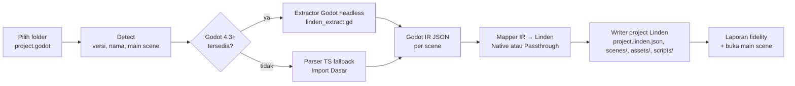

# Spec: Bridge — Import Project Godot ke Linden Engine

Oct 24, 2026 · @accept

## Ringkasan

Bridge saat ini **tidak bisa** mengimpor project Godot. Tombol "Import Scene (.tscn)" hanya mencoba membaca satu file yang di-hardcode (`<project>/main_scene.tscn`). Karena berjalan di renderer tanpa akses filesystem, hasilnya selalu world kosong. Live Sync juga gagal (`WebSocketServer is not a constructor`), dan build Godot gagal walau panel menulis "Ditemukan Godot".

Spec ini mengganti alur tersebut dengan **Import Project** yang memakai **Godot sendiri (mode headless) sebagai parser utama**, dijalankan di main process. Pendekatan ini sudah diuji pada project nyata `Godot-Game-Template-main` (Godot 4.7.2): **119 dari 119 scene termuat, 2.333 node, dalam 0,5 detik**, termasuk 2 scene yang gagal di parser TypeScript kita. Parser TypeScript tetap ada sebagai fallback "Import Dasar" bila Godot tidak terpasang.

## 1. Kondisi saat ini (hasil investigasi)

### 1.1 Bug yang terlihat di screenshot

| # | Gejala | Akar masalah | Lokasi |
| --- | --- | --- | --- |
| B1 | Import Scene tidak menghasilkan apa-apa | Path di-hardcode `${projectPath}/main_scene.tscn`. Di renderer `nodeFs` = `null`, lalu fallback ke IPC `file:load` yang masih stub (`data: null`), sehingga teks kosong dan world kosong | `editor/panels/BridgePanel.tsx:137-151`, `engine/godot/GodotBridge.ts:140-160`, `electron/main.ts` handler `file:load` |
| B2 | `Sync error: WebSocketServer is not a constructor` | `SyncServer` meng-import paket `ws` di renderer. Di browser, `ws` hanya stub tanpa `WebSocketServer`. Server WebSocket harus jalan di proses Node | `engine/godot/sync/SyncServer.ts:6`, `GodotBridge.startLiveSync` |
| B3 | Status bar: "Godot executable not found…" padahal panel menulis "Ditemukan Godot di …/Godot 2.app" | (a) Panel menerima path bundle `.app` (folder), bukan binary `Contents/MacOS/Godot`. (b) Preset export tidak membawa `godotExecutable` dari Bridge, jadi `findSystemGodot(undefined)` hanya mencari di `/Applications` dan `PATH` | `BridgePanel.tsx:60-79`, `electron/main.ts` `export:run` (`findSystemGodot(preset.godotExecutable)`) |
| B4 | Panel menulis "Ditemukan" tanpa memvalidasi | Path langsung disetel sebagai `detectedGodot` setelah Browse, tanpa menjalankan `--version` | `BridgePanel.tsx:69-70` |

### 1.2 Transmuter yang ada (`engine/transmuter`) diuji pada project nyata

Perintah: `transmuter convert Godot-Game-Template-main --to linden --out <tmp>` (dijalankan dari bundle rolldown pada salinan project).

| Klaim Transmuter | Kenyataan |
| --- | --- |
| Skor **99%**, 932 item "full" | Semua node ditulis sebagai `type="Node"` tanpa properti, transform, atau script. Status "full" tidak bermakna |
| Versi sumber `4.3` | Project memakai `config/features=PackedStringArray("4.7")`; versi di-hardcode di `GodotImporter.detect` |
| 119 scene → output | Hanya **72 file** `.lscn`. Ada 38 nama file `.tscn` yang dipakai lebih dari sekali di folder berbeda, dan output diratakan ke satu folder sehingga saling timpa |
| Format output | `.lscn` (teks mirip tscn), **bukan** `.lscene` yang dibuka editor |
| Aset | 0 dari 217 PNG, audio, dan font disalin |
| Script | 0 dari 125 `.gd` disalin atau ditranspilasi ke output |
| Parser | 2 scene gagal: `credits_label.tscn` (BBCode `[font_size]` di string multi-baris) dan `level_2.tscn` (string `"[_][_]\n[_][_]"`). `TscnParser` membaca `[` di awal baris dalam string sebagai header section |
| Instance sub-scene | 153 node `instance=` tidak diekspansi (Godot mengekspansinya menjadi total 2.333 node) |

### 1.3 Profil project uji

`/Users/asep/Downloads/Godot-Game-Template-main`, Godot 4.7, 119 `.tscn`, 125 `.gd`, 14 `.tres`, 217 `.png`, 5 addon, 3 autoload.

| Tipe node (raw, 767 total) | Jumlah | Dukungan Linden hari ini |
| --- | --- | --- |
| Control/UI (Button, Label, *Container, Dialog, …) | ±560 | Tidak ada sistem UI |
| Node, Timer, AudioStreamPlayer, CanvasLayer | ±70 | Tidak ada padanan |
| 2D (Node2D, CollisionShape2D, …) | ±25 | `Physics2D` / `Renderer2D` parsial |
| 3D (Node3D, CSGBox3D, CollisionShape3D, …) | 46 | `ComponentMap` memetakan Node3D, MeshInstance3D, Camera3D, lampu, RigidBody3D, CollisionShape3D. **CSGBox3D belum** |

Kesimpulan: project ini terutama UI. Import yang jujur harus **menyimpan** node yang belum didukung (passthrough) tanpa kehilangan data, dan melaporkannya dengan jelas, bukan mengklaim 99%.

## 2. Tujuan

1. **File → Import → Godot Project…** dan tombol **Import Project** di Bridge mengubah folder berisi `project.godot` menjadi project Linden baru yang langsung bisa dibuka.
2. Semua scene termuat. Hierarki, nama, transform, script, instance, dan aset tetap ada. Node yang belum didukung disimpan sebagai passthrough dan bisa diekspor kembali ke Godot tanpa kehilangan data.
3. Laporan fidelity yang jujur: Native, Passthrough, Dilewati, Error, per scene dan per tipe.
4. Semua akses filesystem, child process, dan WebSocket berjalan di main process (bisa diuji, tidak bergantung pada sandbox renderer).
5. Memperbaiki B1–B4.

**Non-tujuan (v1)**

- Merender UI Control Godot di viewport Linden (perlu sistem UI terpisah).
- Menjalankan GDScript di Linden. Script disalin apa adanya dan ditranspilasi menjadi stub dengan `TRANSMUTER-TODO`.
- Import Godot 3.x (ditolak dengan pesan jelas, sesuai perilaku sekarang).
- Sinkronisasi dua arah otomatis setelah import (Live Sync tetap fitur terpisah).

## 3. Arsitektur



Semua tahap A–H berjalan di **main process** (`electron/bridge/`), dipanggil lewat IPC. Renderer hanya menampilkan wizard, progress, dan laporan.

### 3.1 Mengapa Godot sebagai parser utama

Format `.tscn` punya instance, scene turunan (inherited), override properti, `sub_resource`/`ext_resource`, dan string multi-baris. Godot sendiri adalah implementasi referensi yang selalu benar untuk versinya. Godot juga sudah diminta user di langkah "Hubungkan" Bridge. Uji coba di §1 membuktikan Godot 4.7.2 headless memuat 119/119 scene dalam 0,5 detik setelah `--import` (2,7 detik, sekali saja).

## 4. Desain rinci

### 4.1 Validasi executable Godot (perbaikan B3, B4)

Fungsi baru `resolveGodotExecutable(input)` di `electron/bridge/godotExec.ts`:

1. Path berakhiran `.app` → `<path>/Contents/MacOS/Godot`.
2. Jalankan `<exe> --version` (timeout 5 detik), parse `4.7.2.stable.official…`.
3. Tolak jika bukan binary, timeout, atau versi < 4.3. Pesan error menjelaskan alasannya.
4. Hasil `{ path, version }` disimpan di `userData/bridge-settings.json` (spesifik mesin, **tidak** di `project.linden.json`).
5. `export:run`, `godot:build`, dan import memakai path ini bila preset tidak menyebut executable.
6. UI "Hubungkan" hanya menulis "✓ Godot 4.7.2 di …" setelah validasi sukses.

`findSystemGodot` di `electron/main.ts` dan `GodotBuildRunner.findGodotExecutable` disatukan ke fungsi ini.

### 4.2 Detect

`bridge:import:detect(dir)` membaca `project.godot` dan mengembalikan:

```ts
interface GodotProjectInfo {
  dir: string
  name: string            // [application] config/name
  godotVersion: string    // config/features, mis. "4.7"; fallback dari config_version
  configVersion: number   // 5 = Godot 4
  mainScene: string | null // run/main_scene
  autoloads: { name: string; path: string }[]
  viewport: { width: number; height: number }
  inputActions: string[]  // kunci di [input]
  counts: { scenes: number; scripts: number; resources: number; assets: number }
  addons: string[]
}
```

`configVersion <= 4` → ditolak: "Project Godot 3.x belum didukung. Buka di Godot 4 lalu simpan ulang."

### 4.3 Extractor Godot headless

**Isolasi:** project disalin ke `userData/bridge-cache/<sha1(dir+mtime)>/` (tanpa `.git`, `.godot`). Folder asli user **tidak pernah ditulisi**. Cache dipakai ulang bila tidak berubah.

**Langkah:**

1. `godot --headless --path <cache> --import` (membuat `.godot/imported`, wajib sebelum `load()` tekstur).
2. `godot --headless --path <cache> --script res://.linden/linden_extract.gd -- --out <cache>/.linden/ir`
   - Script dikirim bersama aplikasi di `resources/bridge/linden_extract.gd` dan disalin ke cache.
   - Untuk setiap `.tscn`: `load()` → `PackedScene` → `get_state()` (struktur tanpa ekspansi, untuk mempertahankan instance) **dan** `instantiate()` (nilai akhir setelah override).
   - Tulis satu JSON per scene (format §4.4), lalu `summary.json`.
3. Stdout dan stderr di-stream ke tab Output. Timeout per project 120 detik, bisa dibatalkan.

Prototipe yang sudah diuji ada di Lampiran A.

### 4.4 Godot IR (kontrak antara extractor dan mapper)

```ts
interface GodotSceneIR {
  path: string                    // res://scenes/game/levels/level_2.tscn
  inheritsFrom?: string           // scene turunan
  nodes: GodotNodeIR[]            // urutan depth-first
  connections: { from: string; signal: string; to: string; method: string; flags: number }[]
}
interface GodotNodeIR {
  path: string                    // relatif ke root, "." = root
  name: string
  type: string                    // get_class(), mis. "Button"
  instance?: string               // res:// scene yang di-instance (tidak diekspansi di IR)
  script?: string                 // res://…gd
  groups: string[]
  props: Record<string, GodotValue> // hanya properti PROPERTY_USAGE_STORAGE yang berbeda dari default
}
type GodotValue =
  | null | boolean | number | string
  | { $t: 'Vector2' | 'Vector3' | 'Color' | 'Quaternion'; v: number[] }
  | { $t: 'Transform3D'; basis: number[]; origin: number[] }
  | { $t: 'Transform2D'; v: number[] }
  | { $t: 'Resource'; path?: string; type: string; props?: Record<string, GodotValue> }
  | { $t: 'NodePath'; v: string }
  | GodotValue[] | { [k: string]: GodotValue }
```

Fallback parser TS menghasilkan IR yang sama (tanpa ekspansi instance yang sudah di-resolve Godot, dan ditandai `source: 'ts-parser'`).

### 4.5 Mapper IR → Linden

Diperluas dari `engine/godot/mapping/ComponentMap.ts`. Setiap node menjadi satu `Entity`:

| Kelas | Tipe Godot | Hasil di Linden |
| --- | --- | --- |
| Native | Node3D, MeshInstance3D (Box/Sphere/Capsule/Cylinder/Plane), Camera3D, DirectionalLight3D, OmniLight3D, SpotLight3D, RigidBody3D, StaticBody3D, CollisionShape3D, **CSGBox3D/CSGSphere3D/CSGCylinder3D** (baru, dipetakan ke primitif) | Komponen Linden (`Transform`, `MeshRenderer`, `Camera`, `Light`, `RigidBody`, `Collider`) |
| Native 2D | Node2D, Sprite2D, CollisionShape2D, RigidBody2D, StaticBody2D | Komponen `Renderer2D` / `Physics2D` yang ada |
| Passthrough | Semua tipe lain (Control, Button, Label, *Container, Timer, AudioStreamPlayer, CanvasLayer, …) | `Entity` + `GodotPassthroughComponent { godotType, props, script }`. Tampil di Hierarchy dengan badge abu-abu "Godot: Button", Inspector read-only |
| Instance | Node dengan `instance` | `Entity` dengan komponen `PrefabInstance { source: 'scenes/…lscene' }`, lalu anak dari scene sumber diekspansi saat load (memakai `engine/scene/prefab.ts`) |
| Script | `script` | `ScriptRef { source: 'scripts/…gd', transpiled?: 'scripts/…ts' }` |
| Signal | `connections` | Disimpan di komponen `GodotSignals` (passthrough), dilaporkan sebagai "tidak dieksekusi" |

Konversi koordinat memakai `engine/transmuter/core/CoordinateConverter.ts` (Godot dan Linden sama-sama Y-up, kanan-tangan, jadi transform hanya disalin; diverifikasi lewat test).

### 4.6 Writer project Linden

Output: `<lokasi>/<nama>/` (dialog sama dengan New Project; default nama dari `config/name`).

```
MyGodotGame/
  project.linden.json        # name, scenesInBuild (main scene pertama), input.actions dari [input],
                             # display dari viewport, bridge.source { engine:'godot', version:'4.7', path }
  scenes/<path asli>.lscene  # struktur folder res:// dipertahankan (tidak ada tabrakan nama)
  assets/<path asli>         # png, jpg, svg, wav, ogg, mp3, ttf, otf, glb, gltf
  scripts/<path asli>.gd     # salinan asli
  scripts/<path asli>.ts     # hasil GDScriptTranspiler (stub + TRANSMUTER-TODO), opsional
  godot/                     # salinan .tres, .import, project.godot untuk round-trip export
  import-report.json
  import-report.html
```

- Scene ditulis dengan `SceneSerializer.serialize` (format `linden-scene` v2) sehingga **langsung bisa dibuka** dengan Open Scene.
- Penulisan atomik: tulis ke `<nama>.importing/`, lalu rename setelah sukses. Batal atau gagal → folder sementara dihapus, tidak ada project setengah jadi.

### 4.7 Laporan fidelity

Status per node: **Native**, **Passthrough** (data disimpan, belum dirender/disimulasikan), **Dilewati** (dengan alasan), **Error**. Ringkasan:

- Skor tampilan = `native / total` dan `(native + passthrough) / total` (data terjaga), keduanya ditampilkan. Tidak ada lagi satu angka 99% yang menyesatkan.
- Tabel per tipe Godot: jumlah dan status.
- Daftar scene yang gagal, dengan path dan pesan error dari Godot.
- Aset dan script yang disalin, beserta ukurannya.

### 4.8 UX

**Bridge → kartu 2 "Sinkronkan"** diganti menjadi dua kartu:

- **Import Project dari Godot** (tombol utama): membuka wizard 4 langkah.
  1. **Sumber**: folder project (default dari "Path Project Godot"); langsung tampil ringkasan Detect (nama, versi, jumlah scene/script/aset, addon).
  2. **Tujuan**: nama dan lokasi project Linden; opsi Transpile GDScript (ya/tidak), Salin addon (ya/tidak).
  3. **Proses**: progress bertahap (Salin → Import Godot → Ekstrak 37/119 scene → Mapping → Tulis) + log streaming + tombol Batal.
  4. **Hasil**: ringkasan fidelity, tombol **Buka Project**, **Lihat Laporan**, **Tampilkan di Finder**.
- **Scene tunggal** (sekunder): Export Scene (.tscn), Import Scene (.tscn) dengan dialog pilih file (bukan path hardcode), Live Sync.

Jika Godot belum valid, langkah 1 menampilkan "Import Dasar tanpa Godot: instance tidak diekspansi, 2 dari 119 scene mungkin gagal" + tombol "Hubungkan Godot".

Menu: **File → Import → Godot Project…** membuka wizard yang sama.

### 4.9 IPC (main process)

| Channel | Arah | Isi |
| --- | --- | --- |
| `bridge:godot:validate` | invoke | `{ input }` → `{ ok, path, version } \| { ok:false, reason }` |
| `bridge:import:detect` | invoke | `{ dir }` → `GodotProjectInfo \| { error }` |
| `bridge:import:run` | invoke | `{ jobId, dir, dest, name, options }` → `{ status, projectPath, reportPath, summary }` |
| `bridge:import:cancel` | invoke | `{ jobId }` |
| `bridge:import:progress` | event | `{ jobId, stage, done, total, message }` |
| `bridge:import:log` | event | `{ jobId, line }` |
| `bridge:scene:import` | invoke | `{ tscnPath }` → `{ sceneJson, report }` (perbaikan B1) |
| `bridge:sync:start` / `bridge:sync:stop` | invoke | Server `ws` di main process (perbaikan B2) |
| `bridge:sync:message` | event | Pesan dari addon Godot diteruskan ke renderer |

Semua channel didaftarkan lewat wrapper `handle()` dan `shared/ipcChannels.ts` (lihat `SPEC-Fix-IPC-No-Handler-project-create.md`).

### 4.10 Perbaikan parser TS (fallback)

- Tokenizer `TscnParser` sadar string: `[` di dalam string (termasuk multi-baris dan escape `\"`) tidak dianggap header section.
- Resolusi `instance=ExtResource("id")` ke path `res://`; ekspansi instance rekursif dengan deteksi siklus.
- Versi dibaca dari `config/features`, tidak di-hardcode `4.3`.

## 5. Rencana implementasi

| Fase | Isi | Hasil yang bisa dicoba |
| --- | --- | --- |
| 1 | Validasi executable (§4.1), perbaiki B3/B4, satukan deteksi Godot | "Ditemukan Godot 4.7.2"; build Godot jalan dengan `Godot 2.app` |
| 2 | Pindahkan IO Bridge ke main: `bridge:scene:import` dengan dialog file, `bridge:sync:*` (B1, B2) | Import satu `.tscn` 3D menghasilkan entity; Live Sync start tanpa error |
| 3 | Detect + extractor Godot headless + IR (§4.2–4.4) | `import-report.json` dengan 119/119 scene untuk project uji |
| 4 | Mapper + writer + laporan (§4.5–4.7) | Project Linden baru terbuka dan main scene tampil di Hierarchy |
| 5 | Wizard UX + menu (§4.8) | Alur end-to-end dari UI |
| 6 | Fallback parser TS (§4.10) | Import Dasar tanpa Godot |

## 6. Strategi test

**Fixture** `fixtures/godot/mini-3d/` (project Godot 4 kecil, dibuat dengan Godot lalu di-commit):

- `main.tscn`: Node3D root, MeshInstance3D BoxMesh dengan StandardMaterial3D, Camera3D, DirectionalLight3D, RigidBody3D + CollisionShape3D, CSGBox3D.
- `player.tscn` di-instance 2× di `main.tscn` dengan override posisi.
- `ui/hud.tscn`: Control, Label dengan teks BBCode multi-baris yang mengandung `[`.
- `scripts/player.gd`, `assets/icon.png`, `[input]` dengan 2 action, 1 autoload.
- Dua file dengan nama sama di folder berbeda (`a/level.tscn`, `b/level.tscn`).

**Test:**

1. **Unit, tanpa Godot (CI default):**
   - `TscnParser`: string multi-baris dengan `[`, escape, BBCode.
   - Mapper: IR JSON yang direkam dari fixture (`fixtures/godot/mini-3d.ir/*.json`, di-commit) → entity, komponen, transform yang diharapkan.
   - Writer: struktur folder, tidak ada tabrakan nama, `project.linden.json` valid, `.lscene` lolos `SceneSerializer.deserialize`.
   - Laporan: hitungan Native/Passthrough benar.
   - `resolveGodotExecutable`: `.app` → `Contents/MacOS/Godot`, versi < 4.3 ditolak (dengan `child_process` di-mock).
2. **Integrasi dengan Godot** (dijalankan bila env `GODOT_BIN` diset; job CI terpisah mengunduh Godot 4.3 dan versi terbaru):
   - Extractor pada fixture menghasilkan IR yang identik dengan IR rekaman (golden test). Perbedaan = regresi atau perubahan versi Godot yang harus ditinjau.
   - Import end-to-end fixture → project Linden → buka `main.lscene` → jumlah entity sama dengan jumlah node yang diekspansi Godot.
   - **Round-trip:** export kembali ke `.tscn` → Godot headless `load()` sukses, dan transform Node3D sama (toleransi 1e-5).
3. **Acceptance manual** pada `Godot-Game-Template-main` (Lampiran B).

## 7. Acceptance criteria

- [ ] Browse ke `Godot 2.app` menghasilkan "✓ Godot 4.7.2" dan path binary `…/Contents/MacOS/Godot`; build preset Godot tidak lagi gagal dengan "executable not found".
- [ ] Start Live Sync berjalan tanpa error; addon `linden_bridge` bisa terhubung ke port 6007.
- [ ] Import Scene (.tscn) membuka dialog file dan mengisi Hierarchy sesuai isi scene.
- [ ] Import Project `Godot-Game-Template-main`: **119/119 scene** ditulis sebagai `.lscene` dengan struktur folder asli, **0 scene hilang karena tabrakan nama**.
- [ ] Jumlah entity per scene = jumlah node dari `PackedScene.get_state()` (instance tetap 1 entity + `PrefabInstance`); setelah ekspansi prefab saat load, totalnya **2.333** seperti hasil Godot.
- [ ] 217 PNG dan semua audio/font tersalin; 125 `.gd` tersalin.
- [ ] `project.linden.json` berisi nama "Game Template", main scene `scenes/opening/opening.lscene`, viewport 1280×720, input actions dari `[input]`.
- [ ] Laporan menampilkan versi **4.7** (bukan 4.3) dan skor Native vs Passthrough yang terpisah.
- [ ] Folder project Godot asli tidak berubah sama sekali (tidak ada `.godot/` baru, tidak ada file dengan mtime lebih baru dari waktu mulai import).
- [ ] Batal di tengah proses tidak meninggalkan folder project setengah jadi.
- [ ] Tanpa Godot: Import Dasar berjalan, `credits_label.tscn` dan `level_2.tscn` ter-parse.
- [ ] Semua test unit lulus di CI tanpa Godot; job integrasi lulus dengan Godot 4.3 dan terbaru.

## 8. Risiko

| Risiko | Mitigasi |
| --- | --- |
| Godot tidak terpasang di mesin user | Fallback Import Dasar + tombol unduh; laporan menyebut keterbatasannya |
| Script `@tool` / autoload menjalankan kode saat `load()` | Extractor memakai `--headless` di salinan cache; timeout 120 detik; error per scene tidak menghentikan scene lain |
| Project besar (ribuan scene, GB aset) | Salin dengan hardlink bila satu volume; progress per file; cache berbasis hash |
| Perubahan format antar versi Godot | Golden IR per versi di CI; extractor hanya memakai API publik (`PackedScene.get_state`, `get_property_list`) |
| User mengira UI Godot akan tampil di viewport | Badge "Godot: Button" + catatan di laporan: "Passthrough: data disimpan, belum dirender" |

## 9. Pertanyaan terbuka

- [ ] Apakah cache import (`userData/bridge-cache`) dibersihkan otomatis (mis. > 7 hari) atau manual dari Settings?
- [ ] Transpile GDScript ke TS default aktif atau nonaktif, mengingat hasilnya masih stub?
- [ ] Sistem UI Linden (agar Control Godot bisa tampil) dijadikan spec terpisah berikutnya?

---

## Lampiran A — Prototipe extractor yang sudah diuji

Dijalankan pada salinan project dengan Godot 4.7.2.stable.official (`/Users/asep/Downloads/Godot 2.app`):

```bash
GB="/path/Godot.app/Contents/MacOS/Godot"
cd <salinan-project>
"$GB" --headless --path . --import                       # 2,7 dtk, sekali
"$GB" --headless --path . --script res://dump_all.gd      # 0,5 dtk
# LINDEN_SUMMARY:{"scenes":119,"ok":119,"failed":[],"nodes_instantiated":2333,"instance_nodes":183}
```

```gdscript
extends SceneTree
func _init():
	var files = []
	_scan("res://", files)
	var ok = 0; var fail = []; var nodes = 0; var inst = 0
	for f in files:
		var p = load(f)
		if p == null or not (p is PackedScene): fail.append(f); continue
		var r = p.instantiate()
		if r == null: fail.append(f); continue
		var st = [r]
		while st.size() > 0:
			var n = st.pop_back(); nodes += 1
			if n.scene_file_path != "" and n != r: inst += 1
			st.append_array(n.get_children())
		r.free(); ok += 1
	print("LINDEN_SUMMARY:" + JSON.stringify({"scenes": files.size(), "ok": ok, "failed": fail, "nodes_instantiated": nodes, "instance_nodes": inst}))
	quit()
func _scan(d, files):
	var da = DirAccess.open(d)
	for f in da.get_files():
		if f.ends_with(".tscn"): files.append(d.path_join(f))
	for s in da.get_directories():
		if s != ".godot": _scan(d.path_join(s), files)
```

Varian per scene (tipe, path, transform, rect, script, instance) juga sudah diuji pada `level_2.tscn`, scene yang gagal di `TscnParser`. Versi produksi (`resources/bridge/linden_extract.gd`) menambahkan `get_state()`, properti `PROPERTY_USAGE_STORAGE`, resource, signal, dan output per file.

## Lampiran B — Checklist acceptance manual

1. Bridge → Hubungkan → Browse ke `Godot 2.app` → muncul "✓ Godot 4.7.2".
2. File → Import → Godot Project… → pilih `Godot-Game-Template-main`.
3. Langkah Sumber menampilkan: Game Template, Godot 4.7, 119 scene, 125 script, 5 addon.
4. Tujuan: `~/Documents/Linden Projects/GameTemplate` → Import.
5. Progress mencapai 119/119; laporan: Native, Passthrough, 0 Error.
6. Buka Project → judul `GameTemplate — Scene: opening — Linden Engine`; Hierarchy menampilkan node `opening.tscn` dengan badge Godot pada node UI.
7. Buka `scenes/game/levels/level_3.lscene` → node CSGBox3D tampil sebagai kubus di viewport.
8. Bridge → Export Scene (.tscn) → buka hasilnya di Godot → hierarki dan transform sama.
9. Folder `~/Downloads/Godot-Game-Template-main` tidak berubah: tidak ada `.godot/` baru dan tanggal modifikasi file tetap (folder ini bukan repo git, jadi bandingkan dengan `find -newer`).
