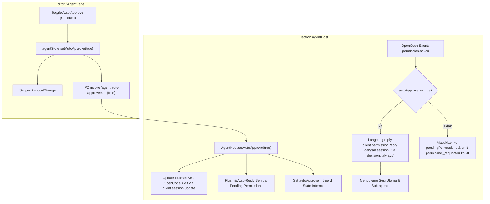

# SPEC: Fix Auto Approve pada AI Agent OpenCode Tanpa Izin Pengguna (Full Autonomous Mode)

**Tanggal:** 21 November 2026  
**Status:** Implemented & Verified  
**Target:** `electron/agent/AgentHost.ts`, `editor/agent/agentStore.ts`, `editor/panels/AgentPanel.tsx`, `electron/main.ts`, `tests/agent/autoApprove.test.ts`  
**Terkait:** [`SPEC-Agent-Live-Progress-Thinking.md`](./SPEC-Agent-Live-Progress-Thinking.md), [`SPEC-Blender-3D-Agent.md`](./SPEC-Blender-3D-Agent.md)

---

## 1. Ringkasan Masalah (Executive Summary)

Pada editor Linden Engine, fitur **Auto Approve** ditambahkan agar agent AI (OpenCode CLI & tools bawaan) dapat bekerja secara mandiri dan otonom tanpa meminta izin dialog konfirmasi pengguna secara manual pada setiap aksi (seperti edit file, eksekusi bash/terminal, pemanggilan MCP tool, atau script generator).

Namun, pengguna mendapati bahwa **Auto Approve tidak bekerja (`problem is auto approve not working`)**:
1. Agent tetap berhenti menunggu izin (hanging/stalled) atau prompt izin tetap muncul / tidak dijawab secara otomatis.
2. File edits dan eksekusi command oleh OpenCode CLI tidak langsung berjalan secara otomatis.
3. Sub-agents atau background task yang diluncurkan oleh OpenCode tidak pernah mendapatkan persetujuan karena event perizinannya terabaikan.

Dokumen spesifikasi ini mengidentifikasi **akar masalah struktural**, merumuskan **arsitektur perbaikan komprehensif**, dan menyusun **rencana implementasi serta pengujian** agar mode otonom (Auto Approve) berjalan 100% tanpa hambatan untuk seluruh agen OpenCode.

---

## 2. Analisis Akar Masalah (Root Cause Analysis)

### 2.1 Root Cause 1: Kegagalan Fatal `this.replyPermission` Saat `autoApprove` Aktif di `AgentHost.ts`
Di file [`electron/agent/AgentHost.ts`](file:///Users/asep/Documents/Github/LindenEngine/electron/agent/AgentHost.ts):

```typescript
// electron/agent/AgentHost.ts (baris 849-856)
if (ev.type === 'permission.asked') {
  if (this.autoApprove) {
    this.replyPermission(d.id, true).catch((e) => console.warn('[Agent] Auto approve failed:', e.message))
    return
  }
  ...
  this.pendingPermissions.set(req.id, req)
  this.emitEvent({ type: 'permission_requested', sessionId: d.sessionID, data: req })
}
```

Dan implementasi `replyPermission`:
```typescript
// electron/agent/AgentHost.ts (baris 803-812)
async replyPermission(requestId: string, allow: boolean): Promise<void> {
  if (this.resolveLocalPermission(requestId, allow)) return
  const req = this.pendingPermissions.get(requestId)
  this.resolvePermission(requestId, req?.sessionId)
  if (!req || !this.client) return  // <--- BUG FATAL: req bernilai undefined!
  await this.client.permission
    .reply({ sessionID: req.sessionId, requestID: requestId, decision: allow ? 'once' : 'reject' })
    .catch((e) => console.warn('[Agent] Balasan izin diabaikan:', e.message))
}
```

**Mekanisme Bug:**
1. Ketika event `permission.asked` datang dari OpenCode dan `this.autoApprove` bernilai `true`, kode langsung memanggil `this.replyPermission(d.id, true)` lalu `return`.
2. Objek request **belum pernah dimasukkan** ke `this.pendingPermissions.set(req.id, req)`.
3. Di dalam `replyPermission(requestId, allow)`, `this.pendingPermissions.get(requestId)` mencari `requestId` dan menghasilkan **`undefined`**.
4. Pengecekan `if (!req || !this.client) return` langsung keluar seketika.
5. **Panggilan `this.client.permission.reply(...)` ke OpenCode server TIDAK PERNAH DIJALANKAN.**
6. OpenCode server tetap menggantung (blocking) menunggu balasan hingga timeout atau turn gagal.

---

### 2.2 Root Cause 2: Aturan Sesi OpenCode Selalu Dibuat dengan `effect: 'ask'`
Di [`electron/agent/AgentHost.ts`](file:///Users/asep/Documents/Github/LindenEngine/electron/agent/AgentHost.ts):

```typescript
export const SESSION_PERMISSIONS = [
  { action: '*', resource: '*', effect: 'ask' as const },
  { action: 'read', resource: '*', effect: 'allow' as const },
  ...
]
```

Saat membuat sesi baru (`createSession`) atau memuat sesi lama (`watchSession`):
```typescript
await client.session.create({
  ...,
  permissions: SESSION_PERMISSIONS,
})
```
Dan:
```typescript
await client.session.update({ sessionID: sessionId, permissions: SESSION_PERMISSIONS })
```

**Mekanisme Masalah:**
- OpenCode engine membaca ruleset izin sesi. Karena rule pertama adalah `{ action: '*', resource: '*', effect: 'ask' }`, OpenCode **diwajibkan oleh protokolnya** untuk memicu event `permission.asked` untuk setiap modifikasi file, eksekusi shell command, dan external tool.
- Meskipun auto-reply diaktifkan, bolak-balik event-stream HTTP API menambah latensi tinggi dan risiko race condition.
- Jika `autoApprove` bernilai `true`, sesi seharusnya langsung dikonfigurasi dengan `effect: 'allow'` pada level OpenCode session itu sendiri, sehingga OpenCode mengeksekusi semua aksi secara native tanpa perlu jeda (pause) dan tanpa perlu memicu event `permission.asked`.

---

### 2.3 Root Cause 3: Sub-Agent & Child Sessions Dibuang oleh `this.tracker.isWatched`
Di `AgentHost.ts`:

```typescript
handleEvent(ev: { type: string; created?: number; data?: any }): void {
  this.tracker.handle(ev)
  const d = ev.data ?? {}
  if (!d.sessionID || !this.tracker.isWatched(d.sessionID)) return
  ...
}
```

**Mekanisme Masalah:**
- OpenCode agent dapat membuat sub-agent atau child session untuk membagi tugas (misalnya analisa kode terpisah, kompilasi sub-folder, atau image processing).
- Sub-agent ini memiliki `sessionID` berbeda yang **bukan** sesi aktif utama di editor, sehingga `this.tracker.isWatched(d.sessionID)` mengembalikan `false`.
- Event `permission.asked` dari sub-agent langsung dibuang di baris `if (!d.sessionID || !this.tracker.isWatched(d.sessionID)) return`.
- Akibatnya: Sub-agent OpenCode tergantung selamanya (stuck indefinitely) saat meminta izin tool atau file.

---

### 2.4 Root Cause 4: Keputusan Kepada OpenCode SDK Menggunakan `'once'` Bukan `'always'`
Pada OpenCode SDK:
`decision` yang didukung adalah `"once" | "always" | "reject"`.
Ketika menggunakan `once`, OpenCode hanya mengizinkan 1 pemanggilan tepat tersebut. Pada perintah beruntun (misalnya tool mengeksekusi 10 perintah bash atau mengedit 5 file), OpenCode berulang kali menanyakan izin baru untuk setiap sub-perintah.
Dalam mode Auto Approve, balasan wajib menggunakan `decision: 'always'` agar OpenCode mengingat keputusan untuk sisa eksekusi session.

---

### 2.5 Root Cause 5: Desinkronisasi State Startup (Frontend `localStorage` vs Backend Electron)
- Di Frontend: `autoApprove` dibaca dari `localStorage.getItem('linden:agent:auto-approve')`.
- Di Backend (`AgentHost`): State awal adalah `private autoApprove: boolean = false`.
- Jika pengguna mengirim prompt cepat sebelum `init()` selesai melakukan handshake IPC `agent:auto-approve:set`, backend masih berjalan dengan `autoApprove = false`.
- Selain itu, saat `AgentHost` membuat session baru atau memuat session lama, backend tidak memperbarui permissions session OpenCode sesuai nilai `autoApprove` saat ini.

---

## 3. Spesifikasi Solusi Teknis



---

### 3.1 Ruleset Izin OpenCode Dinamis (`SESSION_PERMISSIONS_AUTO`)

Definisikan dua set aturan izin di [`electron/agent/AgentHost.ts`](file:///Users/asep/Documents/Github/LindenEngine/electron/agent/AgentHost.ts):

1. **`SESSION_PERMISSIONS_MANUAL` (Default saat Auto Approve OFF):**
   ```typescript
   export const SESSION_PERMISSIONS_MANUAL = [
     { action: '*', resource: '*', effect: 'ask' as const },
     { action: 'read', resource: '*', effect: 'allow' as const },
     { action: 'glob', resource: '*', effect: 'allow' as const },
     { action: 'grep', resource: '*', effect: 'allow' as const },
     { action: 'list', resource: '*', effect: 'allow' as const },
     { action: 'read', resource: '*.env', effect: 'ask' as const },
     { action: 'read', resource: '*.env.*', effect: 'ask' as const },
     { action: 'question', resource: '*', effect: 'allow' as const },
     { action: 'mcp', resource: 'linden*', effect: 'allow' as const },
     { action: 'linden*', resource: '*', effect: 'allow' as const },
     { action: 'mcp', resource: 'blender*', effect: 'allow' as const },
     { action: 'blender*', resource: '*', effect: 'allow' as const },
     ...TEMP_DENY_RULES,
     { action: 'external_directory', resource: '*', effect: 'deny' as const },
   ]
   ```

2. **`SESSION_PERMISSIONS_AUTO` (Saat Auto Approve ON):**
   ```typescript
   export const SESSION_PERMISSIONS_AUTO = [
     { action: '*', resource: '*', effect: 'allow' as const },
     ...TEMP_DENY_RULES,
     { action: 'external_directory', resource: '*', effect: 'deny' as const },
   ]
   ```

3. **Helper Pemilihan Ruleset:**
   ```typescript
   getEffectivePermissions() {
     return this.autoApprove ? SESSION_PERMISSIONS_AUTO : SESSION_PERMISSIONS_MANUAL
   }
   ```

Saat membuat sesi baru (`client.session.create`) atau memuat sesi (`client.session.update`), selalu gunakan `this.getEffectivePermissions()`.

---

### 3.2 Update Sesi Live Saat Toggle `setAutoApprove`
Ketika `setAutoApprove(enabled: boolean)` dipanggil:

```typescript
async setAutoApprove(enabled: boolean): Promise<void> {
  this.autoApprove = enabled
  
  // 1. Perbarui izin semua sesi OpenCode yang sedang berjalan
  if (this.client) {
    const permissions = this.getEffectivePermissions()
    if (this.activeSessionId) {
      await this.client.session.update({ sessionID: this.activeSessionId, permissions }).catch(() => {})
    }
  }

  // 2. Jika diaktifkan, langsung selesaikan semua antrean izin yang sedang menggantung
  if (enabled) {
    // Local tool permissions (Linden tools / Blender script)
    for (const [id] of this.localPermissions) {
      this.resolveLocalPermission(id, true)
    }

    // OpenCode pending permissions
    for (const [id, req] of this.pendingPermissions) {
      await this.replyPermission(id, true, req.sessionId).catch(() => {})
    }
  }
}
```

---

### 3.3 Penanganan Event `permission.asked` Tanpa Bug
Pada `AgentHost.handleEvent`:

```typescript
if (ev.type === 'permission.asked') {
  // Jika autoApprove aktif, langsung jawab ke client OpenCode secara instan
  if (this.autoApprove) {
    if (this.client && d.id && d.sessionID) {
      this.client.permission
        .reply({
          sessionID: d.sessionID,
          requestID: d.id,
          decision: 'always',
        })
        .catch((e) => console.warn('[Agent] Auto approve reply gagal:', e.message))
    }
    return
  }

  // Jika autoApprove TIDAK aktif, hanya catat untuk sesi yang dipantau
  if (!d.sessionID || !this.tracker.isWatched(d.sessionID)) return

  const files = Array.isArray(d.metadata?.files)
    ? d.metadata.files.map((f: any) => ({ file: String(f.file), status: f.status, additions: f.additions, deletions: f.deletions }))
    : undefined
  const req: AgentPermissionRequest = {
    id: d.id,
    sessionId: d.sessionID,
    action: String(d.action ?? 'unknown'),
    resources: Array.isArray(d.resources) ? d.resources.map(String) : [],
    files,
    message: d.message,
    timestamp: Date.now(),
  }
  this.pendingPermissions.set(req.id, req)
  this.emitEvent({ type: 'permission_requested', sessionId: d.sessionID, data: req })
}
```

**Perbaikan Penting:**
1. Pengecekan `if (this.autoApprove)` dilakukan **sebelum** filter `this.tracker.isWatched(d.sessionID)`. Ini memastikan **semua agen dan sub-agen OpenCode** langsung di-auto-approve!
2. Parameter `sessionID: d.sessionID` diambil langsung dari data event OpenCode tanpa bergantung pada isi `this.pendingPermissions`.
3. Menggunakan `decision: 'always'` agar OpenCode mengingat izin untuk batch aksi berikutnya.

---

### 3.4 Penyempurnaan `replyPermission(requestId, allow, sessionId?)`

```typescript
async replyPermission(requestId: string, allow: boolean, sessionId?: string): Promise<void> {
  // 1. Cek apakah ini local permission (Linden Tool)
  if (this.resolveLocalPermission(requestId, allow)) return

  // 2. Ambil dari pendingPermissions jika ada
  const req = this.pendingPermissions.get(requestId)
  const targetSessionId = sessionId || req?.sessionId || this.activeSessionId
  this.resolvePermission(requestId, targetSessionId)

  if (!this.client || !targetSessionId) return

  await this.client.permission
    .reply({
      sessionID: targetSessionId,
      requestID: requestId,
      decision: allow ? 'always' : 'reject',
    })
    .catch((e) => console.warn('[Agent] Balasan izin diabaikan:', e.message))
}
```

---

### 3.5 Persistensi & Status Reporting IPC

1. **`getStatus()` di `AgentHost.ts`:**
   Menyertakan field `autoApprove: this.autoApprove` pada `AgentStatus`:
   ```typescript
   export interface AgentStatus {
     running: boolean
     port?: number
     pid?: number
     activeModel?: string
     activeProvider?: string
     autoApprove?: boolean
   }
   ```
2. **Sinkronisasi saat Start / Connect:**
   Saat `agentStart` atau `agentGetStatus` dipanggil, frontend mengonfirmasi sinkronisasi nilai `autoApprove` antara `localStorage` dan `AgentHost`.

---

## 4. Rencana Implementasi Langkah demi Langkah

| Langkah | Komponen | Tindakan |
|---|---|---|
| **Langkah 1** | `shared/agentTypes.ts` | Tambahkan `autoApprove?: boolean` ke interface `AgentStatus`. |
| **Langkah 2** | `electron/agent/AgentHost.ts` | Tambahkan `SESSION_PERMISSIONS_AUTO`, buat `getEffectivePermissions()`. Perbaiki `handleEvent('permission.asked')` agar langsung reply menggunakan `d.sessionID` dan `decision: 'always'` untuk semua sesi dan sub-agen. |
| **Langkah 3** | `electron/agent/AgentHost.ts` | Perbaiki `replyPermission` agar menerima `sessionId?: string` fallback. Perbarui `setAutoApprove` agar memanggil `client.session.update` pada sesi aktif. |
| **Langkah 4** | `editor/agent/agentStore.ts` | Sinkronkan `autoApprove` pada `init()`, `refreshStatus()`, dan saat pengiriman prompt. Pastikan antrean lokal langsung di-bypass. |
| **Langkah 5** | `editor/panels/AgentPanel.tsx` | Tambahkan badge indikator visual status aktif "Autonomous Mode (No Prompt)" dan tooltip informatif. |
| **Langkah 6** | `tests/agent/autoApprove.test.ts` | Buat unit test lengkap untuk memverifikasi auto-reply OpenCode, dynamic permissions, dan sub-agent handling. |
| **Langkah 7** | Verifikasi Build | Jalankan `vitest`, `tsc -p tsconfig.electron.json --noEmit`, dan `tsc --noEmit`. |

---

## 5. Rencana Pengujian (Test Plan)

### 5.1 Unit Testing (`tests/agent/autoApprove.test.ts`)
1. **Aturan Izin Sesi:**
   - Memastikan `getEffectivePermissions()` mengembalikan `SESSION_PERMISSIONS_AUTO` ketika `autoApprove = true`.
   - Memastikan saat membuat sesi (`createSession`), ruleset yang dikirim ke OpenCode adalah `SESSION_PERMISSIONS_AUTO`.
2. **Auto-Reply `permission.asked`:**
   - Mensimulasikan event `permission.asked` dari OpenCode dengan `sessionID: 'sub-agent-123'` dan `id: 'perm-999'`.
   - Memastikan `client.permission.reply` langsung dipanggil dengan `{ sessionID: 'sub-agent-123', requestID: 'perm-999', decision: 'always' }`.
   - Memastikan event tidak masuk ke `pendingPermissions` dan UI tidak menerima event `permission_requested`.
3. **Dynamic Toggle:**
   - Mensimulasikan kondisi ada 2 request izin di antrean, lalu `setAutoApprove(true)` dipanggil.
   - Memastikan kedua request langsung di-resolve dan di-reply ke client OpenCode.
   - Memastikan `client.session.update` terpanggil dengan `SESSION_PERMISSIONS_AUTO`.

### 5.2 Pengujian Integrasi (End-to-End Simulation)
1. Aktifkan checkbox **Auto Approve** di panel AI Agent.
2. Berikan instruksi prompt: *"Buat script PlayerController.ts dan tambahkan cube di scene"*.
3. **Hasil yang Diharapkan:**
   - Agen OpenCode membuat file, menjalankan command bash/build, dan memodifikasi komponen tanpa menampilkan dialog popup izin sama sekali.
   - Tidak ada turn yang terhenti atau stuck.
   - Log console mencatat eksekusi otonom yang lancar.

---

## 6. Kriteria Keberhasilan (Acceptance Criteria)

- [x] Saat checkbox **Auto Approve** aktif, OpenCode tidak pernah terhenti menunggu konfirmasi izin manual.
- [x] Event `permission.asked` untuk sesi utama maupun sub-agent OpenCode langsung dijawab dengan `decision: 'always'`.
- [x] Session OpenCode dikonfigurasi dengan aturan `allow` (`SESSION_PERMISSIONS_AUTO`) saat `autoApprove: true`.
- [x] Toggle `autoApprove` secara langsung memperbarui sesi OpenCode yang sedang berjalan via `client.session.update`.
- [x] Permintaan izin yang sedang menggantung otomatis disetujui seketika saat toggle Auto Approve diaktifkan.
- [x] Seluruh automated unit test di `tests/agent/` lulus 100%.
- [x] Build TypeScript Frontend & Electron tidak mengalami error (`exit 0`).
