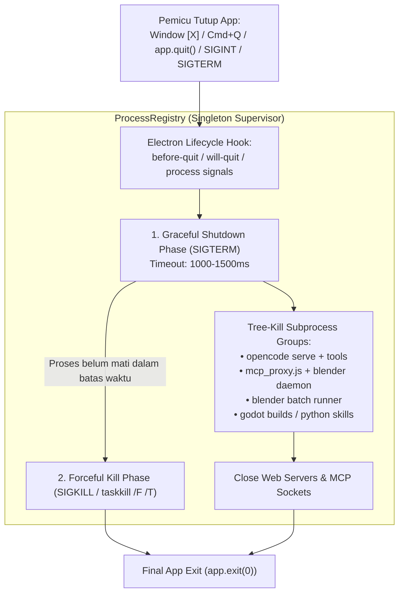

# SPEC: Automatic & Complete Background Process Termination on Application Close

**Status:** Proposed / Ready for Implementation  
**Target:** `electron/main.ts`, `electron/utils/processRegistry.ts`, `AgentHost.ts`, `blenderTools.ts`, `mcp_proxy.js`, `godotExtract.ts`  
**Date:** 20 November 2026  
**Related Specs:** [`SPEC-Blender-MCP-Image-To-3D.md`](./SPEC-Blender-MCP-Image-To-3D.md), [`SPEC-Blender-3D-Agent.md`](./SPEC-Blender-3D-Agent.md), [`SPEC-Fix-IPC-No-Handler-project-create.md`](./SPEC-Fix-IPC-No-Handler-project-create.md)

---

## 1. Ringkasan Eksekutif & Problem Statement

### 1.1 Masalah (The Issue)
Ketika pengguna menutup aplikasi LindenEngine (baik melalui tombol Close jendela [X], menu quit `Cmd+Q` / `Alt+F4`, `app.quit()`, maupun saat menerima sinyal terminasi OS seperti `SIGINT` / `SIGTERM` / reload via `nodemon`), **proses-proses latar belakang (*background child processes*) kerap tertinggal dan terus berjalan secara mandiri (*orphaned processes*)**.

Proses yang bocor dan tertinggal di task manager / background antara lain:
1. **OpenCode Server (`opencode serve`)**: CLI daemon agent beserta HTTP server-nya.
2. **Subproses yang Dijalankan oleh OpenCode / Agent**:
   - Skrip proxy stdio (`blender-bridge/mcp_proxy.js`).
   - Daemon headless Blender (`blender -b -P blender-bridge/mcp_server.py`).
   - Eksekusi bash/terminal commands yang sedang dijalankan oleh agent.
3. **Pekerjaan Blender Prosedural (`blenderTools.ts`)**:
   - Proses batch Blender (`blender -b -P runner.py`) yang sedang melakukan modeling atau rigging (dapat berjalan hingga 120–900 detik).
4. **Subproses Python & AI Forge (`img2threejs.ts`)**:
   - Skrip Python untuk konversi gambar ke Three.js.
5. **Proses Ekspor & Ekstraksi Godot (`main.ts`, `godotExtract.ts`, `godotExec.ts`)**:
   - Proses `godot --headless` saat mengekstrak aset atau melakukan export release.
6. **Server Web Preview / Play Session**:
   - Port HTTP/TCP lokal yang tetap menggantung (*hung socket*).

Akibatnya:
- Penggunaan CPU dan memori RAM tetap tinggi meski aplikasi sudah ditutup.
- Port localhost (seperti 127.0.0.1 port OpenCode, Linden MCP, atau web preview) terkunci, menyebabkan error *port already in use* (`EADDRINUSE`) saat LindenEngine dibuka kembali.
- Menimbulkan bug zombie process pada macOS, Linux, dan Windows.

---

## 2. Analisis Akar Masalah (Root Cause Analysis)

### 2.1 Event `before-quit` Asinkron Tidak Ditunggu oleh Electron
Di [electron/main.ts](file:///Users/asep/Documents/Github/LindenEngine/electron/main.ts#L1345-L1352):
```typescript
app.on('before-quit', async () => {
  for (const s of activeWebServers) {
    try { s.close() } catch (_) {}
  }
  await AgentHost.getInstance().stopServer()
})
```
**Cacat Desain:**
Event `before-quit` pada Electron bersifat **sinkron**. Memberikan callback `async () => { ... }` hanya mengembalikan `Promise` yang **diabaikan** oleh event loop Electron. Electron langsung mematikan proses utama (*main process*) sebelum `stopServer()` sempat mengirimkan sinyal kill ke `opencodeProcess` atau menunggu subproses mati.

Untuk menjalankan operasi asinkron sebelum keluar, pola resmi Electron mengharuskan:
1. Memanggil `event.preventDefault()`.
2. Menyelesaikan seluruh cleanup asinkron.
3. Mengatur flag `isQuitting = true` lalu memanggil `app.quit()` kembali.

### 2.2 Ketiadaan Pembersihan Pohon Proses (*Process Tree Killing*)
Pemanggilan `proc.kill('SIGTERM')` pada Node.js standar hanya mengirimkan sinyal ke proses induk langsung (*immediate child*).
- Pada Windows, atau ketika `shell: true` digunakan (seperti pada `opencode` via shell wrapper `needsShell()`), `proc.kill()` hanya mematikan shell pembungkus (`cmd.exe` / `powershell` / `sh`), sedangkan binary anak sebenarnya (`opencode.exe` atau proses `node` di bawahnya) tetap hidup.
- Subproses bertingkat (misalnya: `LindenEngine` $\to$ `opencode` $\to$ `mcp_proxy.js` $\to$ `blender`) tidak terjangkau oleh `proc.kill()` biasa dan diadopsi oleh init system (PID 1 / `launchd` pada macOS) sebagai zombie/orphan.

### 2.3 Tidak Ada Registry Terpusat untuk Seluruh Child Process
Proses-proses yang di-spawn di berbagai modul:
- `blenderTools.ts:87` (`spawnImpl(bin, args, ...)`)
- `img2threejs.ts:324` (`spawn(python.bin, ...)`)
- `main.ts:1033` dan `main.ts:1141` (`spawn(execPath, args)`)
- `godotExtract.ts:58` (`spawn(bin, args, ...)`)
berjalan secara terisolasi tanpa didaftarkan ke pengawas (*process supervisor / registry*). Jika pengguna menutup aplikasi saat proses-proses ini sedang berjalan, proses-proses tersebut tidak memiliki referensi untuk dihentikan.

### 2.4 Nihilnya Handler Sinyal Terminasi OS
Tidak ada listener untuk `process.on('SIGINT')`, `process.on('SIGTERM')`, atau `process.on('SIGHUP')` di `electron/main.ts`. Jika aplikasi ditutup via terminal (Ctrl+C), kill command, atau reload nodemon dev, proses langsung terhenti mendadak tanpa melalui hook pembersihan sama sekali.

### 2.5 Deteksi Kematian Induk pada Proxy Script (`mcp_proxy.js`)
Pada `blender-bridge/mcp_proxy.js`, proxy hanya mendengarkan `process.stdin.on('data')`. Ketika proses induk mati dan pipa stdin tertutup (*EOF* / `close`), proxy tidak menangkap event `end` / `close` pada stdin, sehingga background daemon Blender yang di-spawn di latar belakang tidak pernah dimatikan.

---

## 3. Arsitektur & Desain Solusi



### 3.1 Komponen 1: Centralized `ProcessRegistry` (`electron/utils/processRegistry.ts`)
Modul baru bertugas mengelola siklus hidup seluruh proses anak, socket, dan server lokal:
- **`registerChildProcess(proc: ChildProcess, metadata: { name: string, pid?: number }): () => void`**:
  - Menyimpan referensi `ChildProcess` aktif ke dalam `Set`.
  - Otomatis menghapus referensi saat proses memancarkan event `'exit'` atau `'close'`.
  - Mengembalikan fungsi unregister untuk pembongkaran manual.
- **`registerServer(server: { close: (cb?: Function) => void }, name: string): () => void`**:
  - Menyimpan server HTTP/TCP aktif (termasuk `activeWebServers` dan `LindenMcpServer`).
- **`killProcessTree(pid: number, signal?: 'SIGTERM' | 'SIGKILL'): Promise<void>`**:
  - **Windows:** Mengeksekusi `taskkill /pid <PID> /T /F` untuk mematikan seluruh hierarki tree proses.
  - **POSIX (macOS / Linux):** Mengirimkan sinyal ke process group (`process.kill(-pid, signal)`) atau melakukan traversal rekursif terhadap anak-anak proses.
- **`terminateAll(timeoutMs?: number): Promise<void>`**:
  - **Tahap 1 (Graceful):** Kirim `SIGTERM` ke seluruh proses terdaftar dan tutup semua server socket.
  - **Tahap 2 (Timeout Guard):** Tunggu maksimal `1000ms`. Jika masih ada proses yang hidup, lakukan `SIGKILL` (atau `taskkill /F /T`) secara paksa.

### 3.2 Komponen 2: Lifecycle Hook Terpadu di `electron/main.ts`
1. **Perbaikan `before-quit`:**
   ```typescript
   let isQuitting = false
   app.on('before-quit', async (event) => {
     if (isQuitting) return
     event.preventDefault()
     isQuitting = true

     try {
       await ProcessRegistry.getInstance().terminateAll(1500)
       await AgentHost.getInstance().stopServer()
     } catch (err) {
       console.error('[App] Error during graceful shutdown:', err)
     } finally {
       app.quit()
     }
   })
   ```
2. **Jaminan Sinkron `will-quit`:**
   Sebagai jaring pengaman terakhir (*safety net*), jika ada proses yang tersisa saat proses Electron benar-benar akan ditutup:
   ```typescript
   app.on('will-quit', () => {
     ProcessRegistry.getInstance().forceKillRemainingSync()
   })
   ```
3. **Penanganan Sinyal Terminal (`SIGINT`, `SIGTERM`, `SIGHUP`):**
   ```typescript
   ;['SIGINT', 'SIGTERM', 'SIGHUP'].forEach((signal) => {
     process.on(signal as NodeJS.Signals, async () => {
       console.log(`[App] Received ${signal}, closing all processes...`)
       try {
         await ProcessRegistry.getInstance().terminateAll(1000)
       } finally {
         process.exit(0)
       }
     })
   })
   ```

### 3.3 Komponen 3: Pendaftaran Child Process di Seluruh Modul
Seluruh pemanggilan `spawn` diwajibkan mendaftarkan diri ke `ProcessRegistry`:
1. **`AgentHost.ts`:**
   - Proses `this.opencodeProcess = proc` didaftarkan ke registry.
   - Server MCP remote didaftarkan ke registry.
2. **`electron/agent/lindenTools/blenderTools.ts`:**
   - `child = spawnImpl(...)` didaftarkan saat mulai eksekusi dan di-unregister saat `finish()`.
3. **`electron/agent/img2threejs.ts`:**
   - `child = spawn(python.bin, ...)` didaftarkan saat mulai dan di-unregister saat selesai.
4. **`electron/main.ts` (Godot CLI & IPC build):**
   - Proses `child = spawn(execPath, args)` didaftarkan ke registry.
5. **`electron/bridge/godotExtract.ts`:**
   - Proses ekstraksi pck didaftarkan ke registry.

### 3.4 Komponen 4: Self-Termination pada Proxy & Daemon (`mcp_proxy.js`)
Pada [blender-bridge/mcp_proxy.js](file:///Users/asep/Documents/Github/LindenEngine/blender-bridge/mcp_proxy.js):
- Tangani penutupan pipa stdin:
  ```javascript
  process.stdin.on('end', cleanupAndExit)
  process.stdin.on('close', cleanupAndExit)

  function cleanupAndExit() {
    if (child) {
      try { child.kill('SIGTERM') } catch {}
      setTimeout(() => {
        try { child.kill('SIGKILL') } catch {}
        process.exit(0)
      }, 500)
    } else {
      process.exit(0)
    }
  }
  ```
- Deteksi kematian proses induk secara periodik (*parent-death heartbeat*) jika didukung OS (misal `process.ppid` berubah menjadi 1 pada POSIX).

---

## 4. Rencana Implementasi & Kode Teknis

### 4.1 Modul Baru: `electron/utils/processRegistry.ts`

```typescript
import { ChildProcess, execSync, spawn } from 'node:child_process'

interface TrackedProcess {
  name: string
  proc: ChildProcess
  pid?: number
}

interface TrackedServer {
  name: string
  server: { close: (cb?: (err?: Error) => void) => void }
}

export class ProcessRegistry {
  private static instance: ProcessRegistry | null = null
  private processes = new Set<TrackedProcess>()
  private servers = new Set<TrackedServer>()

  public static getInstance(): ProcessRegistry {
    if (!ProcessRegistry.instance) {
      ProcessRegistry.instance = new ProcessRegistry()
    }
    return ProcessRegistry.instance
  }

  /**
   * Register a child process to be tracked and killed upon app exit.
   * Returns an unregister function to call when process finishes naturally.
   */
  public registerProcess(proc: ChildProcess, name: string): () => void {
    const item: TrackedProcess = { name, proc, pid: proc.pid }
    this.processes.add(item)

    const cleanup = () => {
      this.processes.delete(item)
    }

    proc.once('exit', cleanup)
    proc.once('close', cleanup)
    proc.once('error', cleanup)

    return cleanup
  }

  /**
   * Register a network/HTTP server to be closed upon app exit.
   */
  public registerServer(server: { close: (cb?: (err?: Error) => void) => void }, name: string): () => void {
    const item: TrackedServer = { name, server }
    this.servers.add(item)
    return () => {
      this.servers.delete(item)
    }
  }

  /**
   * Kill an entire process tree given a root PID across Windows and POSIX.
   */
  public async killProcessTree(pid: number, signal: NodeJS.Signals = 'SIGTERM'): Promise<void> {
    if (!pid || pid <= 0) return

    if (process.platform === 'win32') {
      try {
        execSync(`taskkill /pid ${pid} /T /F`, { stdio: 'ignore' })
      } catch (_) {}
      return
    }

    // POSIX: Kill process group if possible, or try SIGTERM / SIGKILL
    try {
      // If detached/process group leader
      process.kill(-pid, signal)
    } catch (_) {
      try {
        process.kill(pid, signal)
      } catch (_) {}
    }
  }

  /**
   * Terminate all tracked processes and servers with a two-stage shutdown (SIGTERM -> SIGKILL).
   */
  public async terminateAll(timeoutMs = 1200): Promise<void> {
    // 1. Close all servers
    for (const item of this.servers) {
      try {
        item.server.close()
      } catch (_) {}
    }
    this.servers.clear()

    if (this.processes.size === 0) return

    const active = Array.from(this.processes)
    // Stage 1: Send SIGTERM
    for (const item of active) {
      if (item.pid) {
        this.killProcessTree(item.pid, 'SIGTERM').catch(() => {})
      } else {
        try { item.proc.kill('SIGTERM') } catch (_) {}
      }
    }

    // Wait for exit or timeout
    const start = Date.now()
    while (this.processes.size > 0 && Date.now() - start < timeoutMs) {
      await new Promise((r) => setTimeout(r, 100))
    }

    // Stage 2: Force SIGKILL on any stubborn remaining processes
    if (this.processes.size > 0) {
      for (const item of this.processes) {
        if (item.pid) {
          this.killProcessTree(item.pid, 'SIGKILL').catch(() => {})
        } else {
          try { item.proc.kill('SIGKILL') } catch (_) {}
        }
      }
      this.processes.clear()
    }
  }

  /**
   * Synchronous emergency kill (used in will-quit / process exit).
   */
  public forceKillRemainingSync(): void {
    for (const item of this.processes) {
      if (item.pid) {
        if (process.platform === 'win32') {
          try { execSync(`taskkill /pid ${item.pid} /T /F`, { stdio: 'ignore' }) } catch (_) {}
        } else {
          try { process.kill(item.pid, 'SIGKILL') } catch (_) {}
        }
      }
    }
    this.processes.clear()
  }
}
```

### 4.2 Perubahan di `electron/main.ts`

1. Impor `ProcessRegistry`:
   ```typescript
   import { ProcessRegistry } from './utils/processRegistry'
   ```
2. Hubungkan server web:
   ```typescript
   // Gantian penambahan server
   activeWebServers.push(server)
   ProcessRegistry.getInstance().registerServer(server, 'preview-web-server')
   ```
3. Lifecycle shutdown:
   ```typescript
   let isQuitting = false

   app.on('before-quit', async (event) => {
     if (isQuitting) return
     event.preventDefault()
     isQuitting = true

     try {
       await AgentHost.getInstance().stopServer()
       await ProcessRegistry.getInstance().terminateAll(1200)
     } catch (err) {
       console.warn('[Shutdown] Error saat mematikan background processes:', err)
     } finally {
       app.quit()
     }
   })

   app.on('will-quit', () => {
     ProcessRegistry.getInstance().forceKillRemainingSync()
   })

   ;['SIGINT', 'SIGTERM', 'SIGHUP'].forEach((signal) => {
     process.on(signal as NodeJS.Signals, async () => {
       try {
         await ProcessRegistry.getInstance().terminateAll(800)
       } finally {
         process.exit(0)
       }
     })
   })
   ```

### 4.3 Perubahan di `electron/agent/AgentHost.ts`

Di method `spawnServer`:
```typescript
const proc = spawn(bin, ['serve', '--hostname=127.0.0.1', `--port=${port}`], {
  cwd: projectPath,
  env: this.childEnv({ OPENCODE_SERVER_PASSWORD: password, TMPDIR: tmpDir, TMP: tmpDir, TEMP: tmpDir }),
  shell: needsShell(bin),
})
this.opencodeProcess = proc
ProcessRegistry.getInstance().registerProcess(proc, 'opencode-serve')
```

Di method `stopServer`:
Gunakan `killProcessTree` agar tree anak dari `opencode` (termasuk mcp_proxy dan daemon blender) ikut mati:
```typescript
if (proc && proc.pid) {
  ProcessRegistry.getInstance().killProcessTree(proc.pid, 'SIGTERM').catch(() => {})
}
```

### 4.4 Perubahan di `electron/agent/lindenTools/blenderTools.ts`

Pada `runBlenderScript`:
```typescript
child = spawnImpl(bin, args, { cwd: jobDir, env: blenderSpawnEnv(path.join(jobDir, 'user')), shell: false, windowsHide: true, stdio: ['ignore', 'pipe', 'pipe'] })
const unregister = ProcessRegistry.getInstance().registerProcess(child, 'blender-job')

const finish = (out: BlenderRunOutput) => {
  unregister()
  ...
}
```

### 4.5 Perubahan di `blender-bridge/mcp_proxy.js`

Tambahkan deteksi penutupan stdin:
```javascript
function onParentDisconnected() {
  if (child) {
    try { child.kill('SIGTERM') } catch {}
    setTimeout(() => {
      try { child.kill('SIGKILL') } catch {}
      process.exit(0)
    }, 400)
  } else {
    process.exit(0)
  }
}

process.stdin.on('end', onParentDisconnected)
process.stdin.on('close', onParentDisconnected)
```

---

## 5. Rencana Pengujian & Verifikasi

### 5.1 Unit Test: `tests/process/processRegistry.test.ts`
1. **Registrasi & Auto-Unregister:**
   - Spawn proses dummy Node `node -e "setTimeout(()=>{}, 200)"`.
   - Pastikan masuk ke registry.
   - Tunggu proses keluar sendiri, pastikan registry otomatis kosong.
2. **Tree Termination (SIGTERM & SIGKILL):**
   - Spawn proses induk Node yang mem-fork proses anak (nested subproses).
   - Jalankan `terminateAll()`.
   - Verifikasi melalui pengecekan PID (`process.kill(pid, 0)`) bahwa baik induk maupun anak telah mati.
3. **Server Cleanup:**
   - Jalankan `http.createServer().listen(0)`.
   - Daftarkan ke `registerServer`.
   - Panggil `terminateAll()`, verifikasi port kembali bebas.

### 5.2 Integration & Manual Test Scenarios

| Skenario | Langkah Pengujian | Kriteria Lolos (Pass) |
|---|---|---|
| **Skenario 1: Quit saat OpenCode Agent Aktif** | Buka Agent Panel, kirim prompt (OpenCode menyala). Tutup app via `Cmd+Q` atau tombol Close. | Periksa `ps aux \| grep opencode` atau Task Manager. Tidak ada binary `opencode` yang tersisa. |
| **Skenario 2: Quit saat Blender MCP & Bridge Aktif** | Aktifkan Blender MCP mode. Tutup aplikasi LindenEngine. | `ps aux \| grep blender` dan `grep mcp_proxy` tidak menampilkan proses orphan. |
| **Skenario 3: Quit saat Blender Tool Sedang Berjalan** | Trigger pembuatan model 3D (Blender runner aktif 120s). Tutup jendela LindenEngine. | Proses Blender langsung terbunuh seketika, CPU kembali ke 0%. |
| **Skenario 4: Sinyal Terminal (Ctrl+C / nodemon reload)** | Jalankan `npm run electron-dev`. Tekan `Ctrl+C` atau trigger reload file. | Semua child processes dan port server terlepas rapi, tidak terjadi error `EADDRINUSE`. |
| **Skenario 5: Cross-Platform Windows & macOS** | Uji perintah `taskkill /pid ... /T /F` di Windows dan sinyal grup di macOS/Linux. | Berjalan mulus tanpa melempar unhandled exception di kedua platform. |

---

## 6. Checklist Implementasi

- [x] Buat modul [electron/utils/processRegistry.ts](file:///Users/asep/Documents/Github/LindenEngine/electron/utils/processRegistry.ts).
- [x] Update [electron/main.ts](file:///Users/asep/Documents/Github/LindenEngine/electron/main.ts):
  - Perbaiki listener `before-quit` dengan `event.preventDefault()` dan flag `isQuitting`.
  - Pasang fallback sinkron di `will-quit`.
  - Pasang listener `SIGINT`, `SIGTERM`, dan `SIGHUP`.
- [x] Daftarkan child process di [AgentHost.ts](file:///Users/asep/Documents/Github/LindenEngine/electron/agent/AgentHost.ts) (`opencodeProcess` dengan tree-kill).
- [x] Daftarkan child process di [blenderTools.ts](file:///Users/asep/Documents/Github/LindenEngine/electron/agent/lindenTools/blenderTools.ts) (Blender batch runner).
- [x] Daftarkan child process di [img2threejs.ts](file:///Users/asep/Documents/Github/LindenEngine/electron/agent/img2threejs.ts) dan ekspor Godot di [main.ts](file:///Users/asep/Documents/Github/LindenEngine/electron/main.ts) & [godotExtract.ts](file:///Users/asep/Documents/Github/LindenEngine/electron/bridge/godotExtract.ts).
- [x] Tambahkan stdin `end` & `close` listener di [blender-bridge/mcp_proxy.js](file:///Users/asep/Documents/Github/LindenEngine/blender-bridge/mcp_proxy.js) untuk membersihkan daemon Blender saat parent ditutup.
- [x] Buat unit test suite di [tests/process/processRegistry.test.ts](file:///Users/asep/Documents/Github/LindenEngine/tests/process/processRegistry.test.ts).
- [x] Verifikasi `npx tsc -p tsconfig.electron.json --noEmit` (PASS) dan `vitest run` (PASS).
