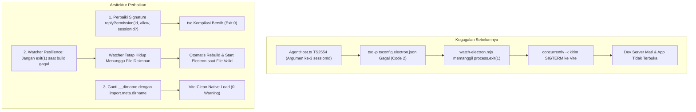

# SPEC: Fix Crash electron-dev Akibat TS2554 replyPermission dan Watcher Exit Fatal

**Tanggal:** 21 November 2026  
**Status:** Ready for Review & Implementation  
**Target:** `electron/agent/AgentHost.ts`, `scripts/watch-electron.mjs`, `vite.config.ts`, `package.json`  
**Terkait:** [`SPEC-Fix-Auto-Approve-OpenCode-Agent.md`](./SPEC-Fix-Auto-Approve-OpenCode-Agent.md), [`SPEC-Fix-Kill-All-Background-Processes-On-Close.md`](./SPEC-Fix-Kill-All-Background-Processes-On-Close.md)

---

## 1. Ringkasan Masalah (Problem Summary)

Saat menjalankan perintah pengembangan `npm run electron-dev`, seluruh lingkungan pengembangan gagal diluncurkan dan aplikasi Electron tidak terbuka sama sekali:

```bash
asep@asepjumadis-MacBook-Air LindenEngine % npm run electron-dev

> linden-engine@2.0.0 electron-dev
> concurrently -k "npm run dev" "wait-on http://127.0.0.1:5173 && npm run electron:watch"

[0] > vite --host 127.0.0.1
[0] (!) Your Vite config uses features that are unsupported by `configLoader: 'native'`:
[0]   - `__dirname` (vite.config.ts:11:25). Use `import.meta.dirname` instead
[0]   VITE v8.3.5  ready in 62 ms
[0]   ➜  Local:   http://127.0.0.1:5173/

[1] > linden-engine@2.0.0 electron:watch
[1] > node scripts/watch-electron.mjs
[1] > linden-engine@2.0.0 build:electron
[1] > tsc -p tsconfig.electron.json --noEmit && node scripts/build-electron.mjs
[1] 
[1] electron/agent/AgentHost.ts(200,46): error TS2554: Expected 2 arguments, but got 3.
[1] [Linden Watch] Build awal gagal: build:electron gagal dengan exit code 2
[1] wait-on http://127.0.0.1:5173 && npm run electron:watch exited with code 1
--> Sending SIGTERM to other processes..
[0] npm run dev exited with code SIGTERM
```

Akibat error kompilasi TypeScript ini, terjadi kegagalan berantai (*cascade failure*) di mana script watch langsung mematikan diri dengan `process.exit(1)`, memicu `concurrently -k` untuk mengirim `SIGTERM` ke Vite server, sehingga workflow developer terhenti total dan aplikasi Linden Engine tidak dapat dibuka.

---

## 2. Analisis Akar Masalah (Root Cause Analysis)

### 2.1 Ketidakcocokan Signature Fungsi `replyPermission` (Error TS2554)
Di `electron/agent/AgentHost.ts` baris 200:

```typescript
// electron/agent/AgentHost.ts
async setAutoApprove(enabled: boolean): Promise<void> {
  ...
  if (enabled) {
    for (const [id] of this.localPermissions) {
      this.resolveLocalPermission(id, true)
    }
    for (const [id, req] of this.pendingPermissions) {
      await this.replyPermission(id, true, req.sessionId).catch(() => {}) // <--- Memanggil dengan 3 argumen
    }
  }
}
```

Namun deklarasi method `replyPermission` sebelumnya adalah:
```typescript
async replyPermission(requestId: string, allow: boolean): Promise<void>
```
Fungsi hanya menerima **2 argumen** (`requestId` dan `allow`), sedangkan pemanggil menyuplai argumen ketiga `req.sessionId`. Hal ini menghasilkan error kompilasi:
`error TS2554: Expected 2 arguments, but got 3.`

### 2.2 Kerapuhan Script Watcher (`scripts/watch-electron.mjs`) Saat Build Awal Gagal
Di `scripts/watch-electron.mjs` baris 119–126:

```javascript
// scripts/watch-electron.mjs
try {
  await buildElectron()
  startElectron()
} catch (err) {
  console.error('[Linden Watch] Build awal gagal:', err.message)
  process.exit(1) // <--- BUG ARSITEKTURAL
}
```

Ketika terjadi error kompilasi TypeScript sekecil apapun pada tahap inisial:
1. `buildElectron()` melempar reject dengan exit code 2.
2. Blok `catch` langsung memanggil **`process.exit(1)`**.
3. Pada `package.json`, skrip dijalankan via `concurrently -k`:
   `"concurrently -k \"npm run dev\" \"wait-on http://127.0.0.1:5173 && npm run electron:watch\""`
4. Flag `-k` (*kill-others*) mendeteksi `electron:watch` exit dengan kode 1 dan langsung mengirim sinyal `SIGTERM` ke Vite dev server (`npm run dev`).
5. Seluruh proses dev langsung mati. Developer tidak diberi kesempatan untuk memperbaiki file saat watcher aktif (berbeda dengan perilaku standar Nodemon / Vite / Chokidar yang tetap bertahan dan menunggu perubahan file).

### 2.3 Peringatan Usang (Deprecation Warning) pada `vite.config.ts`
Vite 8 menampilkan peringatan:
```
(!) Your Vite config uses features that are unsupported by `configLoader: 'native'`:
  - `__dirname` (vite.config.ts:11:25). Use `import.meta.dirname` instead
```
Di Node.js modern (v20.11+ / v22+) dan modul ESM, variabel `__dirname` telah digantikan secara native oleh `import.meta.dirname`.

---

## 3. Rencana Solusi & Perubahan Teknis



---

### 3.1 Penyempurnaan Signature `replyPermission` di `AgentHost.ts`

Pastikan method `replyPermission` mendukung parameter opsional ke-3 `sessionId?: string`:

```typescript
// electron/agent/AgentHost.ts
async replyPermission(requestId: string, allow: boolean, sessionId?: string): Promise<void> {
  if (this.resolveLocalPermission(requestId, allow)) return
  const req = this.pendingPermissions.get(requestId)
  const targetSessionId = sessionId || req?.sessionId || this.activeSessionId
  this.resolvePermission(requestId, targetSessionId ?? undefined)
  if (!this.client || !targetSessionId) return
  await this.client.permission
    .reply({ sessionID: targetSessionId, requestID: requestId, decision: allow ? 'always' : 'reject' })
    .catch((e) => console.warn('[Agent] Balasan izin diabaikan:', e.message))
}
```

Dengan signature ini:
- Pemanggilan 2 argumen `this.replyPermission(id, allow)` tetap valid (kompatibel ke belakang).
- Pemanggilan 3 argumen `this.replyPermission(id, true, req.sessionId)` valid dan type-safe.

---

### 3.2 Resilience pada `scripts/watch-electron.mjs` (Ketahanan Watcher)

Ubah alur startup di `scripts/watch-electron.mjs` agar watcher diinisialisasi terlebih dahulu, dan jika build inisial gagal, proses **tidak mematikan diri**, melainkan tetap mendengarkan perubahan file:

```javascript
// scripts/watch-electron.mjs

// 1. Inisialisasi Watcher terlebih dahulu
const watcher = chokidar.watch(WATCH_PATHS, {
  ignored: (filePath) => {
    if (filePath.includes('node_modules') || filePath.includes('.git') || filePath.includes('dist')) {
      return true
    }
    if (filePath.endsWith('.d.ts') || filePath.endsWith('.test.ts') || filePath.endsWith('.spec.ts')) {
      return true
    }
    return false
  },
  ignoreInitial: true,
})

watcher.on('all', (_event, changedPath) => {
  if (!changedPath.endsWith('.ts')) return
  clearTimeout(debounceTimer)
  debounceTimer = setTimeout(() => {
    restartElectron(changedPath).catch((e) => console.error(e))
  }, 300)
})

// 2. Eksekusi Initial Build & Launch
try {
  await buildElectron()
  startElectron()
} catch (err) {
  console.error('[Linden Watch] Build awal belum berhasil:', err.message)
  console.log('[Linden Watch] Watcher tetap aktif — simpan perbaikan file untuk build ulang otomatis...')
  // JANGAN panggil process.exit(1) di sini agar Vite dev server tidak dibunuh oleh concurrently
}
```

**Keuntungan:**
- Jika developer memiliki kesalahan sintaks / tipe saat menjalankan `npm run electron-dev`, Vite tetap berjalan di port 5173.
- Begitu developer memperbaiki kode dan menekan `Ctrl+S` / `Cmd+S`, watcher otomatis melakukan kompilasi ulang dan meluncurkan jendela Electron tanpa perlu me-restart terminal.

---

### 3.3 Pembaruan `vite.config.ts` (`import.meta.dirname`)

Ganti penggunaan `__dirname` dengan `import.meta.dirname` untuk mendukung Vite 8 `configLoader: 'native'`:

```typescript
// vite.config.ts
import { defineConfig } from 'vite'
import react from '@vitejs/plugin-react'
import path from 'path'

const rootDir = import.meta.dirname || path.resolve()

export default defineConfig({
  plugins: [react()],
  base: './',
  resolve: {
    alias: {
      '@': path.resolve(rootDir, './src'),
      '@engine': path.resolve(rootDir, './engine'),
      '@editor': path.resolve(rootDir, './editor'),
      '@shared': path.resolve(rootDir, './shared'),
    },
  },
  ...
```

---

## 4. Rencana Implementasi Langkah demi Langkah

| Langkah | File Target | Deskripsi Perubahan |
|---|---|---|
| **Langkah 1** | `electron/agent/AgentHost.ts` | Pastikan signature `replyPermission(requestId: string, allow: boolean, sessionId?: string)` konsisten dan seluruh pemanggilan 3 argumen valid. |
| **Langkah 2** | `scripts/watch-electron.mjs` | Pasang watcher sebelum build inisial, hilangkan `process.exit(1)` pada blok `catch` initial build, gantikan dengan pesan siap reload. |
| **Langkah 3** | `vite.config.ts` | Ganti `__dirname` dengan `import.meta.dirname || path.resolve()` untuk menghilangkan warning deprecated config loader. |
| **Langkah 4** | Verifikasi Kompilasi & Build | Jalankan `tsc -p tsconfig.electron.json --noEmit`, `tsc --noEmit`, dan `npm run build:electron`. |
| **Langkah 5** | Verifikasi Dev Environment | Pastikan perintah `npm run electron-dev` dapat dijalankan dengan mulus dan jendela Electron berhasil terbuka. |

---

## 5. Rencana Pengujian & Verifikasi

### 5.1 Pengujian Tipe Statis & Build
```bash
# 1. Pastikan tidak ada error TS2554 pada proses Electron
npx tsc -p tsconfig.electron.json --noEmit

# 2. Pastikan tidak ada error tipe pada Frontend
npx tsc --noEmit

# 3. Pastikan bundle Electron berhasil dibuat
npm run build:electron
```
**Kriteria Lolos:** Seluruh perintah di atas harus menghasilkan exit code 0 tanpa error tipe.

### 5.2 Pengujian Ketahanan Watcher (Resilience Test)
1. Ubah sementara salah satu file TypeScript di `electron/` menjadi memiliki sintaks error buatan.
2. Jalankan `node scripts/watch-electron.mjs`.
3. Verifikasi bahwa proses **tidak exit**, melainkan menampilkan pesan `[Linden Watch] Watcher tetap aktif`.
4. Perbaiki file dan simpan.
5. Verifikasi bahwa proses otomatis mendeteksi perubahan, menjalankan `buildElectron()`, dan berhasil meluncurkan jendela Electron.

---

## 6. Kriteria Keberhasilan (Acceptance Criteria)

- [ ] Tidak ada lagi error `TS2554: Expected 2 arguments, but got 3` pada `electron/agent/AgentHost.ts`.
- [ ] Perintah `npm run build:electron` berhasil dengan exit code 0.
- [ ] Script `scripts/watch-electron.mjs` tidak crash/exit saat terjadi build error awal, melainkan tetap memantau perubahan file.
- [ ] Perintah `npm run electron-dev` dapat meluncurkan Vite server dan jendela aplikasi Linden Engine secara normal.
- [ ] Peringatan `configLoader: 'native'` pada `vite.config.ts` bersih tanpa warning.
