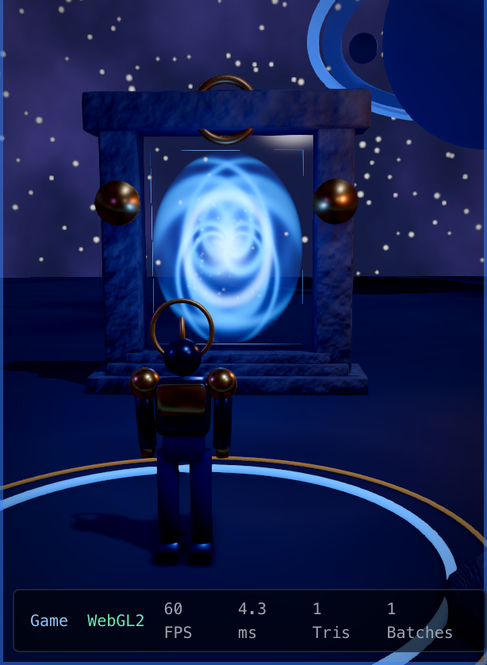

# Cosmic Rift — playable world + Playwright verification

A small playable world inspired by the cosmic-ruins concept: a starfield sky, a ringed planet,
a sculpted stone gate with an animated portal, floating rocks, crystal spires, a rune circle and a
**rigged character with locomotion animations**.



| Asset / file | What it is |
|---|---|
| [`scenes/CosmicRift.lscene`](../../scenes/CosmicRift.lscene) | the world: environment, lights, portal, planet, character |
| [`assets/models/astral_warden.glb`](../../assets/models/astral_warden.glb) | Blender-rigged character, 22 bones, 9 clips |
| [`assets/models/ruin_gate.glb`](../../assets/models/ruin_gate.glb) | Blender-sculpted stone gate with baked PBR maps |
| [`assets/hdri/cosmic_rift.hdr`](../../assets/hdri/cosmic_rift.hdr) | generated nebula environment (IBL) |
| [`assets/sky/cosmic_sky.png`](../../assets/sky/cosmic_sky.png) | 4096px visible sky dome texture |
| [`assets/sky/portal_swirl.png`](../../assets/sky/portal_swirl.png) | portal vortex texture |
| [`generate_sky.py`](generate_sky.py) | regenerates the HDR + sky PNG (numpy + Pillow) |
| [`generate_portal.py`](generate_portal.py) | regenerates the portal swirl |

## Run the automated test

Needs the Vite dev server and a built Electron main process:

```bash
npm run dev                 # terminal 1
npm run test:e2e:cosmic     # terminal 2 (builds main, then drives Electron)
```

The test copies the world into an isolated project and drives the real app with Playwright:

1. opens the project and starts **Play** in the editor;
2. reaches into the live `World` / `SceneBridge` through the opt-in
   `window.__LINDEN_DEBUG__` hook in [`player/main.ts`](../../player/main.ts);
3. asserts the **environment**: HDR IBL, sky texture, fog, color grading, 4 lights,
   gate, planet, particles and 11 models;
4. asserts the **character**: 9 clips, idle state, 22 skeleton bones moving between frames;
5. presses **W**, **Shift+W** and **Space** and checks `Walk`, `Run`, jump/land, and that the
   character actually translates in world space;
6. compares the idle and walking screenshots and fails on console asset errors.

Latest result: **15/15 checks pass** (WebGL2, 60 fps, 5.3 ms frame time).

## Opening it yourself

The repository root is a Linden project, so the scene can be opened directly from
`scenes/CosmicRift.lscene`; press **Play** and use W/A/S/D + Shift + Space.

> The `Playwright MCP` browser tool is not mounted in this DSH session. The test uses the
> Playwright API directly against Electron — the same driver underneath the MCP, with deeper
> access to the ECS world, which a browser-only MCP cannot see.
