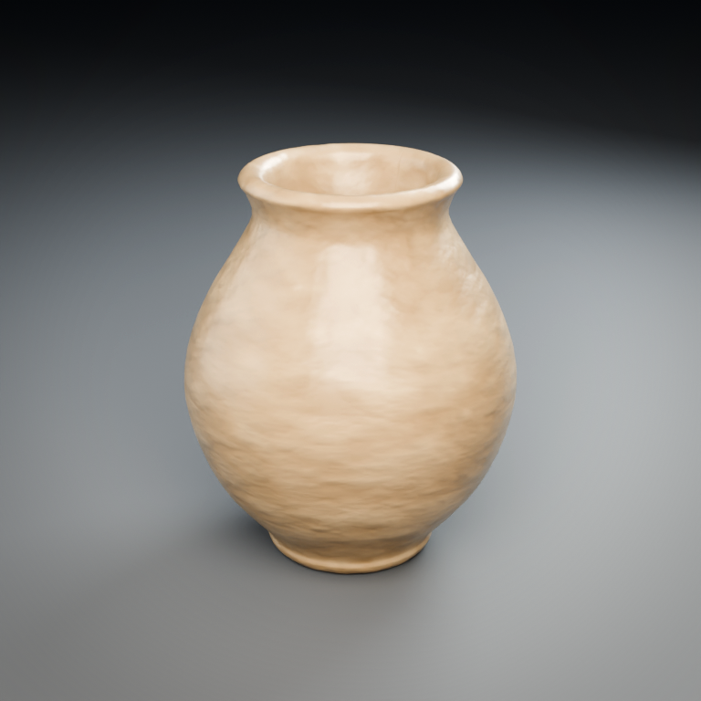
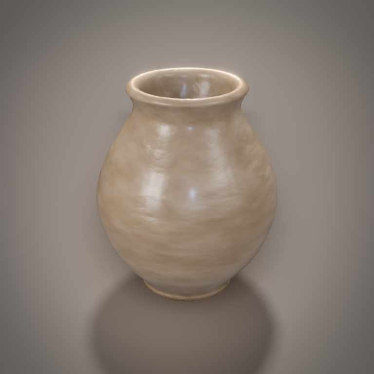

# Photoreal Vase — Blender → Linden Engine

A reproducible example of the photoreal Blender pipeline:

- **geometry**: `lathe` profile smoothed with Catmull-Rom (96 segments)
- **sculpt**: `clay` preset, 0.0014 diagonal strength, 1 subdivision
- **material**: procedural `stone` PBR maps (512px albedo / ORM / normal) baked into the GLB, clearcoat glaze
- **grade**: AgX + Medium High Contrast + CDL (contrast 1.12, saturation 1.08, vignette 0.2)
- **preview**: Cycles, 768px, 64 samples

The result is `assets/models/photoreal_vase.glb` (1.8 MB, 50,304 triangles, all textures embedded) and the scene
`scenes/PhotorealStudio.lscene`, which applies the same `colorGrade` inside Linden Engine.





## Reproduce

From the repository root:

```bash
blender -b --factory-startup -Y --offline-mode --python-exit-code 1 \
  -P blender-bridge/runner.py -- \
  --spec samples/photoreal-vase/spec.json \
  --out /tmp/photoreal_vase.glb \
  --previews /tmp/photoreal-vase-previews
```

`/tmp/photoreal-vase-previews/preview_three_quarter.png` is the graded Cycles render. Copy the GLB into
`assets/models/` and open `scenes/PhotorealStudio.lscene` in the editor.

The same run through the agent (`linden_blender_build {name, spec}`) returns the three previews as MCP images and
imports the GLB automatically.

## Tuning

| Goal | Change |
|---|---|
| More/less surface detail | `objects[0].sculpt.strength` (0.001–0.01) and `subdivide` |
| Different material | `material.texture.pattern`: `marble`, `wood`, `fabric`, `rust`, `brushed`, … |
| Finer texture | `texture.resolution` 512 → 1024 (adds ~3 MB), or `scale` |
| Warmer product shot | `grade.colorGrade.temperature` (positive = warm) |
| Heavier budget | `params.segments` and `sculpt.subdivide`; the runner auto-decimates above 280k triangles |

`npm run test:e2e:photoreal` renders the same scene in the real Electron player runtime and writes
`docs/media/engine-photoreal-*.png`; `samples/photoreal-vase/engine-preview.png` is a copy for quick viewing.

The scene uses Y-up; the GLB exporter converts Blender Z-up automatically (`export_yup=True`).
